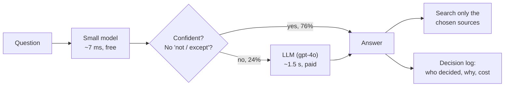
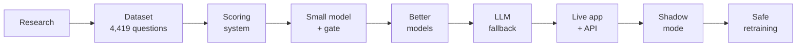
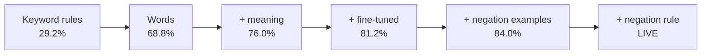
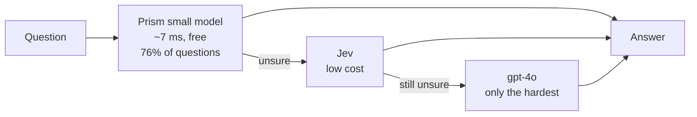
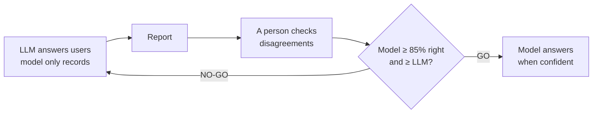

# Aetherion Prism: a fast, low-cost source router for the Aetherion platform

**From:** Sara Mamatha · **Date:** 22 October 2026
**Code:** https://github.com/saramamatha19/AetherionPrism

---

## Source Routing

When someone asks a work assistant a question such as *"is the login bug fixed yet?"*, the
assistant first has to decide **where to look**: the knowledge base, Jira, Confluence, Slack,
Notion, Gmail or the web. Most tools ask a large LLM to make that choice for every question. That
takes about 1.5 seconds and costs money each time, even for easy questions.

**Prism** puts a small model in front of the LLM. The small model handles 3 out of 4 questions
by itself in about 7 milliseconds at no cost. Only the questions it is unsure about go to the LLM.

| Tested on 1,200 questions the model never saw during training | Small model alone | LLM alone (gpt-4o) | **Prism (small model + LLM)** |
|---|---|---|---|
| Real-world questions, exactly right | 84.0% | 74.6% | **84.2%** |
| Hard trick questions, exactly right | 40.4% | 71.4% | **52.1%** |
| Questions answered without the LLM | 100% | 0% | **76%** |
| Time per decision | ~7 ms | ~1.5 s | **~7 ms for 3 in 4 questions** |
| Cost per 1 million questions | $0 | $1,731 | **$414 (76% lower)** |

**What I'm asking for:** access to Jev, so I can test it directly against Prism (about 5 cents for
the whole dataset), and a chance to run Prism in shadow mode on real questions inside Aetherion.

---

## Aetherion already uses Jev. Why use  ML model?

There are two ways Jev could do this job, so I looked at both.

**Option 1: Jev does the whole job by itself.** Every question goes to Jev, and Jev decides where
to search. I expect Prism to do this job better:

- **This job has to be learned.** The line between sources (Notion notes vs Confluence docs, the
  knowledge base vs Confluence) is specific to how we work. I tested Laya, a ready-made model
  that works the same way as Jev. Used as it comes, it got **fewer than half** of the real-world
  questions right (43.8%). It only became competitive **after fine-tuning on my labels** (85.8%).
- **Jev cannot be fine-tuned.** TypeSafe's documentation says all customers share the same model,
  and you can only change how you word the questions. Prism is trained on our labels and keeps
  learning from real questions.
- **Jev's known weak spots are this task's hardest questions.** TypeSafe's documentation says Jev
  reads negations literally and is less reliable with indirect wording. Questions like "not in
  Slack" or "anything except Jira" are exactly where routing goes wrong.
- **Prism is faster.** About 7 ms on our own server, against about 100 ms for each call to Jev.

**Option 2: Jev as the backup.** Prism answers the 3 in 4 questions it is sure about, and only the
unsure ones go to Jev, instead of to gpt-4o as today. This is what I'd recommend. Each model
does what it's best at: Prism handles our everyday questions quickly, and Jev handles the rest
at a fraction of gpt-4o's cost (see section 6).

I couldn't test Jev directly, so I tested Laya, a model that works the same way. Out of the box it got only 43.8% of everyday questions right; after training on my labels it reached 85.8%. That tells me this task depends on learning our own labels. Jev can't be trained that way, so I expect it to be weaker at choosing sources for us, while still being a great fit for general judgments where no special labels are needed.

Both options are based on my Laya results, because I haven't had access to Jev yet. Testing both
options on my 1,200 test questions costs about 5 cents, and it's the first thing I'd like to do.

---

## 1. The problem

Every assistant that answers from company data has to pick its sources first. There are three
ways to do it:

| Approach | What goes wrong |
|---|---|
| Search all 7 sources every time | Slow, and the results are full of noise from the wrong places |
| Ask an LLM every time | About 1.5 s and a paid call on every question, even "thanks!" |
| **Prism: small model first, LLM only when unsure** | Fast and free for most questions, with the LLM kept for the hard ones |

## 2. The main idea behind the project

> **Use the cheapest thing that is good enough, measure everything, and never trust a model
> until it has proved itself.**

Three rules followed from that:

1. **Measure first.** I built the scoring system before building any model, so every change has
   a number attached to it.
2. **Change one thing at a time.** Each model differs from the previous one in one way, so I
   know what caused each gain.
3. **Prove it before it goes live.** Nothing reaches users until it passes a shadow test on real
   questions and a person approves it.

## 3. How one decision is made

- **Words and meaning.** The model reads the exact words (TF-IDF) and the meaning of the sentence
  (a small BGE model that I fine-tuned on my own labels).
- **7 yes/no judges, one per source.** This lets one question need several sources, or none at
  all (for example "thanks!").
- **Confidence comes from the least sure judge.** If any single source is uncertain, the whole
  answer counts as uncertain.
- **The gate (0.13)** is the lowest confidence at which the model's answers are still at least
  80% right. It is chosen automatically on separate data, never on the test set.
- **Negation rule.** Questions containing "not", "except" or "skip" always go to the LLM, because
  the small model was often confidently wrong on them. This rule cut those mistakes from 42 to 12.

## 4. How I built it, from start to end

**The dataset.** No public dataset fits this task, so I built one with **4,419 questions**:
3,219 for training and 1,200 for testing. The test set is frozen and was never used for training
or tuning.

| Part | Rows | Why it's there |
|---|---|---|
| Real-world questions from 10 public datasets | 2,500 | Realistic and traceable |
| Hard cases: traps, negation, vague and multi-source questions | 1,160 | Real data rarely contains them |
| Same topic under every source (22 topics) | 759 | Stops the model guessing the source from the topic |

One lesson from the dataset: my first model was "cheating" by guessing the source from the topic.
After I added the same topics under every source, accuracy on unseen topics went from **36% to
74%**.

**The model journey** (real-world questions, exactly right):

I trained 8 small models, tested 1 large ready-made model (Laya) and 1 LLM (gpt-4o). All 15
model versions are saved and none was overwritten. One file, `models/champion.json`, records
which model is live and why.

<b>👉 CLICK HERE to see all 8 small models after the gate (full table)</b>

After the gate, each model answers only the questions it is confident about and sends the rest to the LLM. Each cell shows two numbers that belong together: **how much it answers itself / how often it's right when it does**. A model can look very accurate just by answering very little.

| Model | What changed | Gate | All: answers / right | Real-world: answers / right | Same-topic: answers / right | Hard: answers / right |
|---|---|---|---|---|---|---|
| `tfidf_logreg_v3` | Words + 7 judges | 0.11 | 61.0% / 69.5% | 67.4% / 82.5% | 69.3% / 82.5% | 53.2% / 50.7% |
| `bge_logreg_v1` | Meaning only | 0.21 | 41.8% / 71.5% | 58.0% / 86.9% | 17.1% / 58.3% | 33.4% / 49.2% |
| `tfidf_bge_logreg_v1` | Words + meaning | 0.15 | 63.8% / 71.8% | 74.6% / 87.9% | 59.3% / 81.9% | 55.4% / 49.7% |
| `ft_bge_logreg_v1` | Fine-tuned meaning | 0.15 | 75.2% / 67.4% | 83.0% / 88.4% | 70.7% / 84.8% | 69.3% / 40.5% |
| `tfidf_ft_bge_logreg_v1` | Words + fine-tuned meaning | 0.09 | 86.7% / 65.8% | 90.6% / 87.0% | 88.6% / 87.1% | 82.7% / 39.3% |
| `tfidf_ftv2_bge_logreg_v1` | + 1,000 negation examples | 0.11 | 85.8% / 69.2% | 92.0% / 88.0% | 87.9% / 91.1% | 79.8% / 43.8% |
| `tfidf_ftsplit_bge_logreg_v1` | Trained on separate halves | 0.16 | 68.6% / 71.0% | 78.4% / 87.8% | 70.7% / 85.9% | 59.3% / 46.7% |
| **`tfidf_ftv2_bge_logreg_v2`** | **+ negation rule (live)** | **0.13** | **76.2% / 71.3%** | **84.0% / 89.3%** | **79.3% / 91.9%** | **68.6% / 45.6%** |

How to read the live row: on real-world questions the model answers 84% by itself and is right on 89.3% of those; the other 16% go to the LLM. Laya and gpt-4o aren't in this table: Laya's full-system results are under the Laya button, and gpt-4o is the fallback itself.

**The LLM fallback.** I improved the gpt-4o prompt from 61.7% to 74.4% right, using training
questions only. LLM answers are recorded once and replayed for free, so every comparison can be
repeated. The whole project spent about $14 on LLM calls.

**Engineering.** It has a web app, an API (`POST /route`), versioned models
with one-command rollback, and a decision log for every question.

## 5. Why I didn't use Jev, and why I expect Prism to do better on this task

**Why I didn't use it.** I didn't have access to Jev (TypeSafe) during the project. Instead I tested
**Laya**, a ready-made model that works the same way as Jev. You ask it plain-language yes/no
questions and it returns a probability for each one. I asked it the same 7 questions ("does
answering this need a search in Jira?" and so on) on the same 1,200 test questions.

**What Laya showed:**

| | Real-world | Hard | Speed per question | Size |
|---|---|---|---|---|
| Laya, used as it comes (no training) | 43.8% | 31.6% | — | 1.6 GB |
| Laya, after fine-tuning on my labels | 85.8% | 43.9% | ~54 ms | 1.6 GB |
| **Prism's small model** | **84.0%** | **40.4%** | **~7 ms** | **~133 MB** |

<b>👉 CLICK HERE to see the full Laya results (alone and in the full system)</b>

All of Laya's settings were chosen on training data, never on the test set.

**Alone**

| System | All | Real-world | Same-topic | Hard |
|---|---|---|---|---|
| Laya, used as it comes | 39.1% | 43.8% | 52.1% | 31.6% |
| Laya, fine-tuned 1 epoch | 60.3% | 77.6% | 75.7% | 41.1% |
| Laya, fine-tuned 3 epochs | 66.2% | 85.8% | 85.0% | 43.9% |
| **Prism's small model** | **63.7%** | **84.0%** | **84.3%** | **40.4%** |
| gpt-4o alone | 74.4% | 74.6% | 85.7% | 71.4% |

**Inside the full system (with gpt-4o as the fallback)**

| Full system | All | Real-world | Same-topic | Hard | Cost / 1M |
|---|---|---|---|---|---|
| Laya fine-tuned + gpt-4o | 70.8% | 82.2% | 85.0% | 57.1% | $404 |
| **Prism small model + gpt-4o** | **70.0%** | **84.2%** | **90.7%** | **52.1%** | **$414** |

Laya scored a little higher alone, but inside the full system it was a tie: better on hard
questions, worse on real-world and same-topic ones. It was also 8× slower and much larger, so I
kept the small model.

**What this means for Jev:**

- Used as it comes, Laya got **fewer than half** of the real-world questions right. It only
  became competitive **after fine-tuning on my labels**.
- **Jev cannot be fine-tuned.** TypeSafe's documentation says all customers share the same model,
  and you can only change how you word the questions.
- TypeSafe's documentation also lists **negation and indirect wording** as known weak spots. Those
  are the exact questions this task finds hardest.
- Even when fine-tuned, Laya only **tied** Prism in the full system (70.8% vs 70.0% on all 1,200
  questions) while being **8× slower and much larger**.

**My expectation:** used without training, Jev is likely to score **below Prism's small model** on
this routing task. The reason is that the line between sources (Notion notes vs Confluence docs,
the knowledge base vs Confluence) is specific to our data and has to be learned. This is an
**expectation based on the Laya results, not yet a measurement.** Confirming it is cheap:

| Running Jev on | Questions | Cost (TypeSafe's price: $0.042 per million input tokens) |
|---|---|---|
| The 1,200 test questions | 1,200 | about **1 cent** |
| The whole dataset | 4,419 | about **5 cents** |
| 1 million questions in production | 1,000,000 | about **$10.50** |

*(Estimates assume ~250 tokens per question including the 7 yes/no questions.)*

## 6. Prism and Jev together on Aetherion

Aetherion already uses Jev for other decisions. **Prism doesn't replace Jev; it adds a capability
the platform doesn't have yet: choosing where to search.** The two can also work together.

Jev's strength is cost. It is roughly **165× cheaper per answer than gpt-4o**. That makes it a
strong candidate to replace gpt-4o as Prism's fallback:

| Setup (per 1 million questions) | Cost |
|---|---|
| gpt-4o for every question | ~$1,731 |
| Prism today (small model + gpt-4o) | $414 |
| **Prism + Jev as fallback** | **~$2.50 (estimate)** |

The estimate covers cost only. Whether accuracy holds when Jev is the fallback needs the same
test, which costs about 1 cent on the 1,200 test questions.

### The test plan (a few cents in total)

1. **Setup:** get a Jev API key and ask Jev the same 7 yes/no questions.
2. **Jev alone:** choose its thresholds on training data and score it on the 1,200 test questions.
3. **Jev as the fallback:** Prism answers when confident, and Jev answers the rest.
4. **One comparison table:** accuracy, speed and cost for every setup.
5. **Decide** using the numbers.

## 7. What it takes to run

The small model runs on an ordinary, cheap server. No GPU is needed.

| | What I measured on my laptop (CPU only) |
|---|---|
| Memory | ~670 MB |
| Time per question | ~5 ms (I expect 10–20 ms on a cloud server) |
| GPU | Not needed |
| Server | 1–2 CPU cores, 2 GB memory, about $5–15 a month |
| Retraining | Runs on a laptop, only after 500+ new reviewed questions |

The server price stays the same whether it routes a thousand questions or a million. Jev needs no
server of our own, but every question goes over the network to TypeSafe (about 100 ms per call).

## 8. Built to be trusted - Retraining

- **Shadow mode.** The model runs silently next to the LLM, and users are never affected. It goes
  live only when it is at least 85% right **and** at least as good as the LLM on 500+ real
  questions.
- **The rehearsal said NO-GO**, and I'm reporting that openly. On real-world questions it passes
  (89.3% right when confident), but on hard trick questions it doesn't yet. The safety check
  works.
- **Safe retraining.** A new model must beat the live one on every check, and a person approves the
  switch. I ran 3 retraining rounds, and **all 3 challengers were rejected** because they were
  slightly worse or cost more. Rollback is one command.

<b>👉 CLICK HERE to see the 3 retraining rounds (what changed, why not promoted)</b>

In each round, made-up questions went through the app in shadow mode and the answers were
reviewed. A challenger was trained on the new labels plus the old ones, then compared with the
live model on the same 1,200 test questions. It is promoted only if it is better on every check.

| Round | Challenger | New rows learned | Real-world (live: 84.2%) | Answered without LLM (live: 76.2%) | Result |
|---|---|---|---|---|---|
| 1 · 14 Oct | `_v3` | 439 | 84.0% | 73.3% | Not promoted: slightly worse, ~12% more expensive |
| 2 · 15 Oct | `_v4` | 858 | 83.2% | 73.8% | Not promoted: worse on real-world |
| 3 · 16 Oct | `_v5` | 1,288 | 83.4% | 73.5% | Not promoted: better on hard (52.1% → 54.8%) but worse on real-world, $463 vs $414 |

The rule protected the live model all three times. The model misses sources more often than it
adds wrong ones (125 vs 31), so that's the next thing to fix before adding more data.

- **No company data.** All data is public or written by me, AI-written rows are marked, and every
  row can be traced back to its source.

## 9. What isn't solved yet

- **Go-live needs real questions:** 500+ from colleagues, run through shadow mode.

## 10. Where this could go on Aetherion

The pattern behind Prism is a small fast model first, a stronger model only when unsure, and
everything measured. It isn't limited to choosing search sources. If it works on the platform,
the same approach could be applied to:

- **Tool choice for AI agents:** which tool or API should handle a request.
- **Ticket and email triage:** which team, which priority.
- **Support intent detection:** what the user actually wants, routed to the right flow.
- **Document tagging:** labelling incoming documents by type or owner.
- **Combining with Jev:** Prism-style trained models where our own labels matter, and Jev where a
  general judgment is enough.

## 11. What I need to take it further

1. **Jev API access**, to run the head-to-head test (a few cents).
2. **500+ real questions from colleagues**, for the shadow-mode go-live check.
3. **A place to plug it into Aetherion**, starting in shadow mode so users are never affected.
4. **Guidance from someone on the platform team** on how Jev is used today.

---

## A personal note

I would really like to take this further at Aetherion. My next step would be to understand the
parts of Aetherion's existing codebase that relate to this, such as how questions flow through the
platform and where Jev is used today. Then I'd deploy my own model there, starting in shadow mode
so users aren't affected.

— Sara
