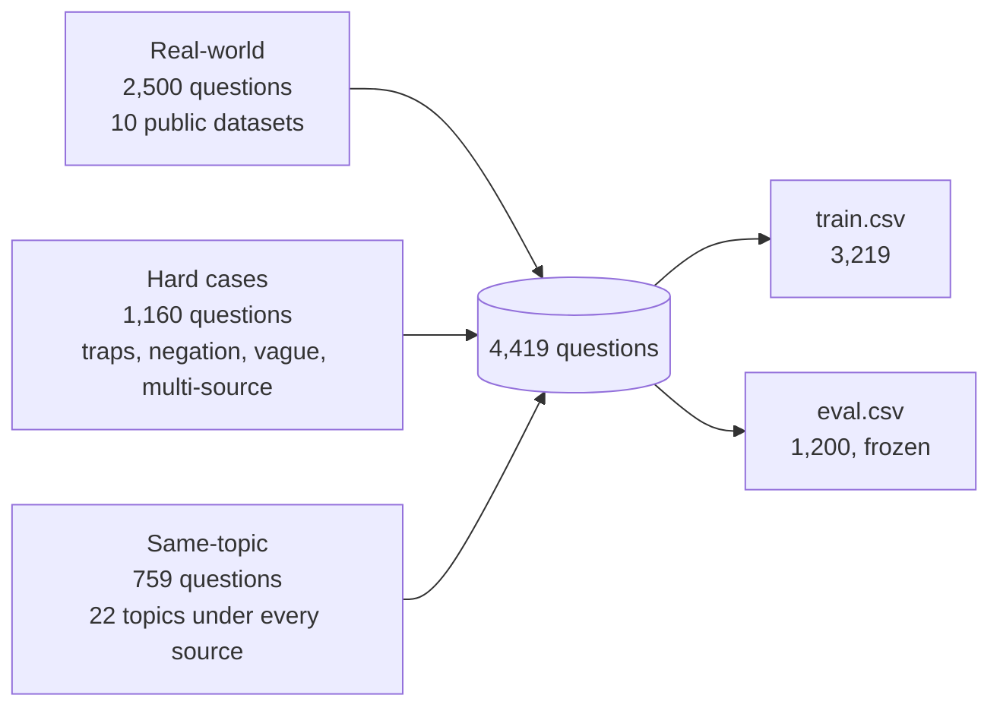
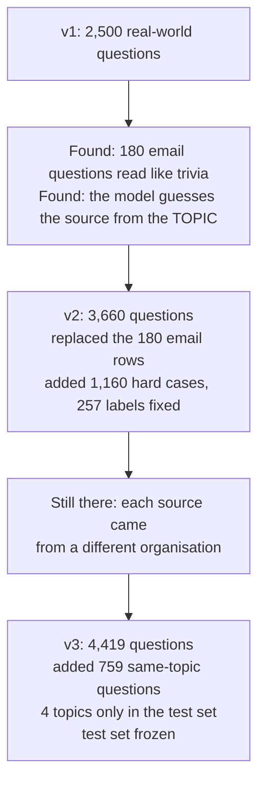

# Dataset

The questions used to train and test the Source Router, where they came from, and how they were
checked.

---

## At a glance

Each row is **a question someone might ask at work** and **the sources where its answer lives**
(for example `jira`, or `slack|gmail`, or nothing for "thanks!").

| | |
|---|---|
| Questions | **4,419**: 3,219 train · 1,200 test (`eval`) |
| Labels | 7 sources: `kb`, `jira`, `confluence`, `slack`, `notion`, `gmail`, `web`, or none |
| Questions with 2+ sources | 449 |
| Questions needing no search | 311 |
| Parts | Real-world (2,500) · Hard cases (1,160) · Same-topic (759) |
| Question types | 7, from "Small talk" to "Implied source" |
| Traceable | Every row has its origin, author type and link in `provenance.csv` |
| Test set | **Frozen**: no row is ever added, removed or changed |

---

## 1. Files and columns

| File | What it contains |
|---|---|
| `data/train.csv` | 3,219 questions to learn from |
| `data/eval.csv` | 1,200 questions for final scores only (frozen) |
| `data/provenance.csv` | Where each row came from, matched by `id` |
| `data/probes/` | Topic-swap test questions, used to measure topic bias (§6) |
| `data/new_labels/` | Reviewed questions added by retraining rounds, one file per round. `train.csv` itself is never edited |

`train.csv` and `eval.csv` have the same 6 columns:

| Column | Meaning | Example |
|---|---|---|
| `id` | Row ID | `q00042` |
| `question` | The question | `is the login bug fixed yet` |
| `labels` | Where the answer is. Several are joined with `\|`; empty = no search needed | `jira` |
| `question_type` | What kind of question it is (§3) | `Implied source` |
| `origin` | Which dataset or set it came from (§4) | `Apache Kafka Jira` |
| `split` | `train` or `eval` | `train` |

`provenance.csv` adds, for every `id`: `written_by` (a person, a benchmark, or AI),
`original_id` and `source_link` (the original record), `split_group` (the document or meeting it
came from, used to keep train and test apart), and `old_labels` / `label_changed` (for the hard
cases that were relabelled, §5).

---

## 2. Labels

A label is **where the answer is actually found**, not a guess from keywords. A question written
from a Jira ticket is labelled `jira` because its answer is in that ticket.

| Label | Where the answer lives | Example question | Rows |
|---|---|---|---|
| `kb` | Official help, how-to and policy articles | "how do I set up direct deposit?" | 726 |
| `jira` | Tickets, bugs, work status | "is the fix for the consumer hang released?" | 803 |
| `confluence` | Specs, designs, runbooks, process docs | "what does the design doc say about failover?" | 644 |
| `slack` | Chat conversations | "what did people suggest in chat for the wifi issue?" | 742 |
| `notion` | Meeting notes, personal and team notes | "what did we decide in Monday's meeting?" | 656 |
| `gmail` | Email | "did the client reply about the invoice?" | 602 |
| `web` | Public knowledge outside the company | "what is a KV cache?" | 525 |
| *(none)* | No search needed | "good morning!" | 311 |

Rows add up to more than 4,419 because a question can have several labels.

### Labelling rules

The same rules are used for every label, every check and every human review (and are given to
the LLM in its prompt):

1. **A named tool counts:** "check Slack for…" includes `slack`.
2. **Negation removes:** "not in Slack" means `slack` is out.
3. **Misleading words don't count:** "parking ticket", "slack off", "the notion of" are not Jira,
   Slack or Notion.
4. **Specs, designs, runbooks, process docs** → `confluence`. **Meeting and personal notes** →
   `notion`. **Official policy or how-to** → `kb`.
5. **Public knowledge** → `web`. Company topics are never `web`, even though Confluence is a website.
6. **No information need** (greetings, thanks, statements) → no label.
7. **Several labels only when clearly needed.**

---

## 3. Question types

Every question has exactly one type. If more than one fits, the type **higher in the list wins**.
The list runs from hardest for a model to easiest. Results are always reported per type, so it is
clear *where* a model fails.

| Type | Meaning | Example → label | Train | Test |
|---|---|---|---|---|
| Small talk | No information needed | "thanks a lot!" → none | 224 | 87 |
| Misleading keyword | A tool's name used with another meaning | "I got a parking **ticket**, do we reimburse that?" → kb | 31 | 48 |
| Excludes a source | Rules a source out | "not the ticket, the design doc for the API" → confluence | 127 | 105 |
| Multiple sources | Needs 2 or more sources | "what did the client email and what did we decide in standup?" → gmail, notion | 232 | 194 |
| Unclear source | Several sources fit, nothing points to one | "anything on feature flags?" | 100 | 67 |
| Names the source | Names the tool or its obvious item | "any emails from the vendor about the outage?" → gmail | 397 | 179 |
| Implied source | Clear need, tool not named | "is the login bug fixed yet?" → jira | 2,108 | 520 |

The test set has proportionally more hard types on purpose, so weaknesses can't hide.

---

## 4. Where the data comes from

### Three parts

| Part | Train / test | What it is | Why it's there |
|---|---|---|---|
| **Real-world** | 2,000 / 500 | Questions from 10 published public datasets | Realistic questions with traceable sources |
| **Hard cases** | 600 / 560 | Keyword traps, negation, vague and multi-source questions, from my earlier project | Real data rarely contains these, but users ask them |
| **Same-topic** | 619 / 140 | 22 topics (KV cache, SSO, billing, postmortems, …), each written under **every** source, from one fictional company's documents (EnterpriseRAG-Bench) | Stops the model guessing the source from the subject |

In the code (`data.part_of`) and the results tables, the same-topic part is called
**"company topics"**.

### Real-world sources

| Dataset | Train | Test | Label(s) | What the questions are | Licence |
|---|---|---|---|---|---|
| EnterpriseRAG-Bench (Onyx) | 351 | 86 | jira, confluence, slack, notion, gmail; some multi-source | Benchmark questions tagged with the sources that answer them | MIT |
| WixQA | 184 | 46 | kb | Real customer help-center questions | MIT |
| CLINC150 | 280 | 70 | kb, web, none | People-written HR questions, definitions and small talk | CC-BY-3.0 |
| MASSIVE (Amazon) | 248 | 62 | gmail, web | People-written assistant requests ("any emails from jo?") | CC-BY-4.0 |
| Natural Questions (Google) | 168 | 42 | web | Real Google searches | CC BY-SA 3.0 |
| ConcurrentQA | 56 | 14 | web | People-written questions answered by Wikipedia | MIT |
| QMSum | 217 | 56 | notion | People-written questions about real meetings | MIT |
| Apache Kafka Jira | 160 | 40 | jira | Written from real Kafka Jira tickets, one per ticket | Public ASF tracker |
| Apache Kafka Confluence | 176 | 44 | confluence | Written from real Kafka design pages, one per page | ASF contributor grant |
| Ubuntu help chat | 160 | 40 | slack | Written from real help-chat conversations | CC-BY-4.0 |

Jira, Confluence and Slack have few public "ask an assistant" questions, so for those one question
was written from each real document (a ticket, a design page, a chat thread). The answer is in that
document, so the label is certain.

### Who wrote the questions

| Written by | Rows |
|---|---|
| Real people (searches, help-center customers, crowd workers) | 1,443 |
| A published benchmark (EnterpriseRAG-Bench) | 437 |
| AI, from a real document (Kafka tickets, design pages, chat threads) | 620 |
| Hand-written hard cases | 263 |
| AI-generated hard cases | 897 |
| AI, from one company's documents (same-topic part) | 759 |

`provenance.csv` shows this for every row.

---

## 5. How it was built: three versions

Each version fixed a problem measured in the one before.

**v1: real-world data (2,500 rows)**
- Downloaded 10 public datasets and mapped their categories to the 7 labels.
- Removed company names (Wix, Enron, Kafka, Redwood) from questions, so the model can't learn
  "Wix → kb".
- Split 2,000 / 500 **by document**: questions from the same ticket, page or meeting never appear in
  both train and test.

*Problems found:* a blind re-check showed 180 email questions read like public trivia (their label
was true but impossible to guess from the question), and a topic-swap test showed the model guessing
the source from the **topic**.

**v2: hard cases and fixes (3,660 rows)**
- Replaced the 180 unclear email questions with real email requests (MASSIVE) and real Google
  searches (Natural Questions).
- Added 1,160 hard cases from my earlier project, converted from 5 labels to 7. 257 labels changed
  (mainly `notion` → `confluence` for specs and runbooks); each change is recorded in
  `provenance.csv`.
- Added the `question_type` column.

*Problem still there:* topic bias. Each real source came from a different organisation (Slack =
Linux chat, kb = website help, and so on), so topic and source were tangled.

**v3: same-topic questions (4,419 rows), current**
- Added 759 questions on 22 shared topics. Each topic is written under every source, all from one
  company's documents, so topic no longer gives the source away.
- 4 whole topics are kept for the test set only, so the test checks **topics the model has never
  seen**.
- v2 rows unchanged. The test set is now frozen.

---

## 6 Using it fairly

- **The test set (`eval.csv`) is only for final scores.** Nothing is tuned on it: not the model,
  not the pass marks, not the gate, not the LLM prompt.
- **Choices are made on slices of train.** The code (`data.split_train`) cuts train into a fit
  slice (2,219, to learn from), a threshold slice (500, to choose each source's pass mark) and a gate
  slice (500, to choose the gate). The slices keep the same mix of parts and use a fixed seed (42).
- **Always report per part and per question type**, never only the total. Hard cases are 47% of the
  test set on purpose, so the total alone looks worse than real use and hides where a model is good.
- **Labels are sets.** `jira|slack` and `slack|jira` are the same answer.
- **Retraining never edits these files.** Reviewed real questions go to `data/new_labels/`, and any
  question that is in the test set is refused.

