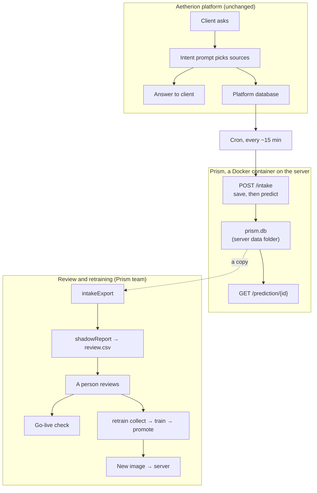

# Prism on the Aetherion platform

How Prism collects real questions from the live Aetherion platform without affecting clients, how
those questions are reviewed and used to retrain the model, and why each part is built the way it
is. To deploy it, see **[DEPLOY.md](DEPLOY.md)**.

---

## In one paragraph

The Aetherion platform already decides where to search with an intent prompt (an LLM). Prism is a
small model that makes the same decision in ~7 ms for free. Before Prism can ever be trusted with
clients, it has to prove itself on **real** questions. So it runs in **shadow mode** next to the
platform: a cron job sends it copies of real questions together with the intent prompt's answer,
Prism saves them and makes its own prediction, and the two are compared, reviewed by a person and
used to retrain. Clients only ever see the platform's normal answer.

## The flow

1. A client asks a question. The platform answers exactly as before and saves the question and the
   intent prompt's answer in its database.
2. Every ~15 minutes, a cron job on the platform side sends the new questions to `POST /intake`.
3. Prism saves each question, then its model predicts the sources right away. Everything is kept
   in one file, `prism.db`, in a folder on the server.
4. When enough questions have been collected (500+), a copy of `prism.db` is exported, compared,
   reviewed by a person, and used for the go-live check and for retraining.
5. A better model becomes a new image, and the server switches to it. The collected questions are kept.

## The parts

| Part | What it does |
|---|---|
| `POST /intake` (`intakeRouter.py`) | Receives up to 500 questions per send: `question_id`, `question`, `intent_answer`. Saves them, then predicts every question not predicted yet. Replies with counts |
| `GET /prediction/{question_id}` (`answerRouter.py`) | Returns Prism's saved prediction for one question: `predicted`, `waiting`, or 404 |
| `intakeStore.py` | The only file that knows where questions are kept (`intake/prism.db`, SQLite) |
| `intakeExport.py` | Turns `prism.db` into the decision log the existing shadow tools read |
| `Dockerfile` · `.dockerignore` | Builds the image: Python, libraries, code, settings, the live model. Nothing else |
| `docker-compose.yml` | How the server runs it: restart on crash, the data folder, a health check |
| `platform_source_names` (in `configs/default.yaml`) | Translates the platform's source names into Prism's 7 |

One row in `prism.db`:

| question_id | question | intent_answer | prism_answer | model_sure | confidence | model_version |
|---|---|---|---|---|---|---|
| 108 | status of ticket ABC-12? | ["jira"] | ["jira"] | 1 | 0.79 | tfidf_ftv2_bge_logreg_v2 |

## Why it's built this way

| Decision | Why |
|---|---|
| **A cron sends copies, instead of the platform calling Prism live** | A live call would change the chat code, and a slow or broken Prism could slow or break the chat. The cron keeps Prism completely out of the client's path |
| **Two endpoints: one to receive, one to read** | Receiving only saves, so it almost never fails and the cron gets a quick reply. Reading is separate, so it can later become the door the platform uses if Prism goes live, without touching intake |
| **Save first, then predict** | Questions are safe even if the model fails. A question that couldn't be predicted is retried on the next send automatically |
| **Each `question_id` saved once** | If Prism's reply is lost, the cron resends the same questions. Duplicates are skipped, so retrying is always safe and nothing is counted twice |
| **The cron moves its bookmark only after a 200 reply** | If Prism is down, nothing is lost: the same questions are sent next time |
| **The model only, no LLM** | The intent prompt already is the LLM side. Prism needs no API key, so there are no secrets in the container, and it costs nothing to run |
| **The platform's source names saved exactly as sent** | An unknown name (e.g. a source Prism doesn't have) never blocks or loses a question. Translation happens only when comparing, and unknown names are counted: they show when it's worth teaching the model a new source |
| **Empty questions skipped and counted; no length limit** | Refusing a whole send would block the cron. Clients ask however they ask; the model reads the first ~400 words, and the full text is saved |
| **Confidence saved with every prediction** | The go-live check is measured on the questions the model is confident about |
| **SQLite, behind one file** | One file, no database server. Duplicate checks and lookups are built in. If the platform prefers its own database later, only `intakeStore.py` changes |
| **Reuse the existing shadow tools** | Review, go-live and retraining were already built and tested. The export only converts the format; the intent prompt plays "the LLM" |
| **Docker, with CPU-only PyTorch** | The server needs nothing but Docker. Leaving out the GPU code keeps the image at ~600 MB instead of several GB |
| **A whitelist `.dockerignore`** | Only what Prism needs can go in, so `.env`, real questions and large unused models can never slip into the image |
| **The image on ghcr.io, and the model in git through Git LFS** | The image is the easiest way to deploy (`docker pull`). The 133 MB fine-tuned model is over GitHub's file limit, so it goes through LFS, which makes the repo able to build the image too |
| **The data folder outside the container** | A container is replaced on every update. The questions live in a server folder linked into it, so they survive |
| **Built for amd64** | Most servers are Intel/AMD. An ARM version is one extra build if needed |

## What was tested

- 143 automated tests, including: duplicates skipped, unknown source names kept, empty questions
  counted, a 20,000-character question saved in full, a broken model losing nothing, and the export
  read by the real shadow report.
- The Docker image: starts with no API key; `/health`, `/intake` (including a resend) and
  `/prediction` work; no `.env` or key inside.
- The data folder: without it, questions are lost when the container is replaced; with it, they survive.
- The published image pulls with no login. The compose file starts healthy and saves questions.

## From 500 questions to a new version

The two steps marked ✍️ are done by a person on purpose: the model never learns from unchecked answers,
and nothing goes live automatically.

| # | Step | Command |
|---|---|---|
| 0 | **Make the repository and the image private first.** From step 6 on, real client words go into git and the image | GitHub settings |
| 1 | Get a copy of `prism.db` from the server | as agreed with the platform |
| 2 | Export | `uv run python -m prism.intakeExport --db <copy>` |
| 3 | Compare, and write the review file | `uv run python -m prism.shadowReport logs/platform_<date>` |
| 4 ✍️ | Review: fill in `correct_answer` in `review.csv` (e.g. `jira\|slack`, or `none`) | Excel |
| 5 | Go-live check: GO / NO-GO (a decision only) | `uv run python -m prism.shadowReport logs/platform_<date> golive` |
| 6 | Turn reviewed questions into training rows | `uv run python -m prism.retrain collect logs/platform_<date>` |
| 7 | Train a challenger and compare it with the live model | `uv run python -m prism.retrain train` |
| 8 ✍️ | Promote only if better on every check; otherwise stop here | `uv run python -m prism.retrain promote <version> "<what>" "<why>"` |
| 9 | Build, test and publish the new image | `docker build --platform linux/amd64 -t prism:v2 .` → test → tag `ghcr.io/saramamatha19/prism:v2` → push |
| 10 | Switch the server to it (the questions are kept) | change `v1` → `v2` in `docker-compose.yml`, then `docker compose pull && docker compose up -d` |
| 11 | Next round: only newer questions | `intakeExport --db <copy> --since <date of last round>` |

If a new model uses a different fine-tuned folder, update the folder name in the `Dockerfile` and
`.dockerignore` before step 9.

## The go-live check

Prism can only be considered for answering clients when, on at least 500 real questions:

- it is at least **85% right** on the questions it's confident about, judged against human-checked
  answers (not against the intent prompt), **and**
- it is **at least as good as the intent prompt** on the same questions.

Even then, going live is a separate decision for the platform's owners, and Prism would answer only
the questions it's confident about. On the test-set rehearsal the result was NO-GO (71.3% vs 77.1%):
real-world questions pass, tricky ones don't. Real questions will show where it stands.

## Data and privacy

- `prism.db` holds real client questions. It stays on the server, is never put in git, and creates
  itself (empty) when Prism first starts.
- A copy for review is handled under the platform's rules for client data.
- The image and the code contain no client data and no secrets.
- A retrained model contains words from the questions it learned from, and training batches contain
  the questions themselves. So the repository and the image become private **before** the first
  retraining on real questions. Making them private afterwards doesn't undo a push.

## Still being agreed with the platform

Confirmed: the intent prompt uses the same 7 source names as Prism, so no translation is needed.

Marked **TO CONFIRM** in [DEPLOY.md](DEPLOY.md): the answer format (a list, and `[]` for no source),
whether message ids are unique and permanent, the server's chip type and data folder, how often the
cron runs, whether port 8000 stays inside the network (if not, `/intake` gets a secret key), how the
collected questions reach the Prism team, and whether the Prism team can update the server itself
(server access, or automatic updates on a new image).
