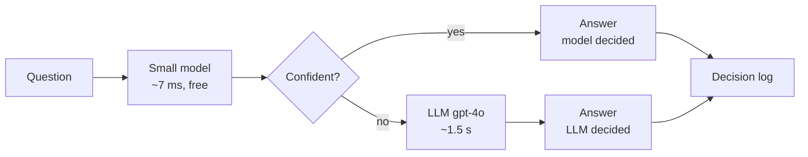
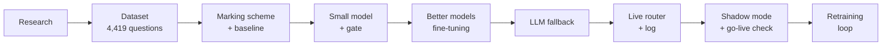
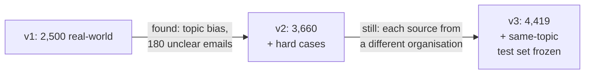
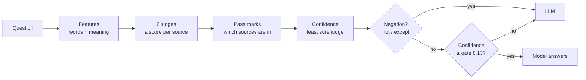
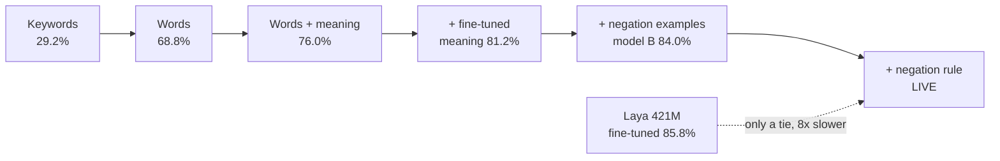
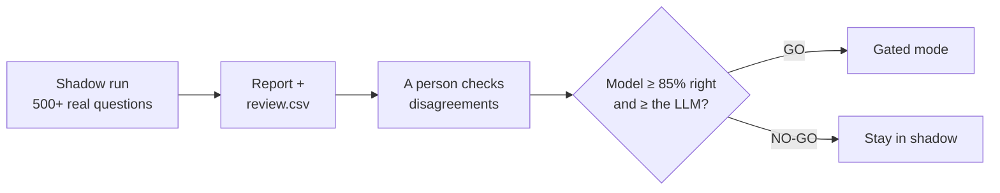
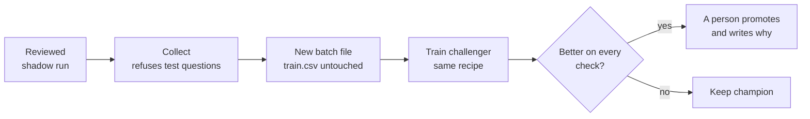

# Aetherion Prism: the Source Router

**When someone asks a question at work, Prism decides where to search for the answer:** the
knowledge base, Jira, Confluence, Slack, Notion, Gmail or the web.

A small, fast model answers most questions in milliseconds, for free. When it isn't sure, it hands
the question to an LLM. Fewer LLM calls, lower cost, faster answers, and accuracy as good as or
better than asking the LLM every time.



## Results

On the **frozen test set** (1,200 questions never used for any choice), always split by part:

| | Model alone | LLM alone | **Model + LLM (live)** |
|---|---|---|---|
| Real-world questions (500) | 84.0% | 74.6% | **84.2%** |
| Same-topic questions (140) | 84.3% | 85.7% | **90.7%** |
| Hard trick questions (560) | 40.4% | 71.4% | **52.1%** |
| Answered without the LLM | 100% | 0% | **76%** |
| Cost per 1M questions | $0 | $1,731 | **$414 (76% cheaper)** |

*% = exactly right (every needed source, nothing extra).* On normal questions Prism matches or
beats the LLM at a quarter of the cost. Hard trick questions (negation, misleading words, vague
questions) are still weak, so most of them go to the LLM.

---

## How I built it

One rule throughout: **build the way to measure before building the thing to measure.** Every step
ended with a number, a written decision and a commit.



| Date (Oct 2026) | Step | Result |
|---|---|---|
| 6 | Research: tools, papers, datasets ([RESEARCH.md](RESEARCH.md)) | Today's tools ask an LLM every time; "cheap model first" (a cascade) is backed by research |
| 6–7 | Dataset, 3 versions ([DATASET.md](DATASET.md)) | 4,419 questions; topic bias found and fixed; test set frozen |
| 8 | Marking scheme + keyword baseline | Baseline: 29.2% on real-world |
| 8 | First small model + confidence gate | 68.8% real-world |
| 10–11 | Meaning embeddings, fine-tuning, negation rule | **84.0%**: model B, the live model |
| 12 | LLM fallback, 4 prompt versions | Full system 84.2%, 76% cheaper |
| 13 | A bigger challenger (Laya, 421M) | Only a tie in the full system, 8× slower → kept model B |
| 13 | Live router, decision log, shadow rehearsal | NO-GO on the test set (hard cases); the checking process proved honest |
| 13–15 | Learning loop, web page, API, 2 practice retraining rounds | Both challengers correctly **not** promoted |

**Why rebuild from scratch?** A first prototype proved the idea, but had 27 real problems (two
defaults silently made the gate 0, so nothing went to the LLM; shadow mode was never run; cost was
undercounted by 23%). Prism was rebuilt so every file is understood and each problem has a named
fix ([the golden rules](#the-golden-rules)).

---

## The dataset

No public dataset exists for this task, so I built one. Each row is a question and **the sources
where its answer actually lives** (one, several, or none). Full details: **[DATASET.md](DATASET.md)**.

| Part | Train / test | What it is | Why |
|---|---|---|---|
| **Real-world** | 2,000 / 500 | From 10 public datasets (EnterpriseRAG-Bench, WixQA, CLINC150, MASSIVE, Natural Questions, QMSum, Kafka Jira and Confluence, Ubuntu chat, ConcurrentQA) | Realistic and traceable |
| **Hard cases** | 600 / 560 | Keyword traps, negation, vague and multi-source questions | Real data rarely has these |
| **Same-topic** | 619 / 140 | 22 topics, each written under every source | Stops guessing the source from the topic |



**Checks:** split by document (same ticket or meeting never in both train and test) · company names
removed · blind re-label of 200 rows agreed 84% (93% after the v2 fix) · topic bias fixed: unseen
topics **36% → 74%**, topic-swap test **43% → 77%** · every row traceable in `provenance.csv`.

**Honest limits:** not company data; part of it is AI-written (all marked); labels checked by AI and
spot-checked by hand, not by two people.

---

## How one decision is made



- **Features:** TF-IDF words and 3–5 letter chunks, joined with a BGE embedding (meaning) fine-tuned
  on our labels.
- **7 judges:** one yes/no logistic regression per source, so "several" and "none" need no special case.
- **Pass marks:** each source has its own, chosen on a separate slice of train (never the test set).
- **Confidence:** for each source, how far its score is from its pass mark (as a share of the room
  on that side); the whole answer is only as sure as its **shakiest** source.
- **Negation rule:** the model is confidently wrong on "not the email, the…", so those go to the LLM.
- **Gate:** computed, not typed: the lowest confidence where the questions the model keeps are
  **≥ 80% right** on its own slice. Saved with the model; a gate of 0 is refused. I first checked
  that low confidence really predicts mistakes (36% right at 0.0–0.1 → 100% at 0.5+).

<details>
<summary><b>Worked example and the confidence formula</b></summary>

```
if score >= mark:  sure = (score - mark) / (1 - mark)
else:              sure = (mark - score) / mark
confidence = the smallest "sure" of the 7 sources
```

"is the login bug fixed yet?": jira scores 0.91 (mark 0.45) → in the answer, sure 0.84; confluence
0.12 (mark 0.40) → sure 0.70, the least sure; the rest are sure 0.72–0.94. Confidence 0.70 ≥ gate
0.13 → **the model answers: no LLM call, ~7 ms, $0.** *(Scores illustrative; marks and gate are the
live model's.)*
</details>

---

## The models I trained

One change at a time; every version kept, never overwritten.



| Model | Real-world | Hard | Answers alone | Note |
|---|---|---|---|---|
| keyword rules | 29.2% | n/a | n/a | The bar to beat |
| `tfidf_logreg_v3` | 68.8% | 40.0% | 61.0% | First model, with gate |
| `tfidf_bge_logreg_v1` | 76.0% | 39.6% | 63.8% | Words + meaning |
| `tfidf_ftv2_bge_logreg_v1` (model B) | 84.0% | 40.4% | 85.8% | Fine-tuned + 1,000 negation examples |
| **`tfidf_ftv2_bge_logreg_v2`** **LIVE** | **84.0%** | 40.4% | 76.2% | Model B + negation rule: confident negation mistakes 42 → 12 |
| Laya fine-tuned (3 epochs) | 85.8% | 43.9% | 77% | Tie in the full system, 54 ms, 1.6 GB |
| gpt-4o prompt v4 | 74.6% | 71.4% | n/a | The LLM alone |

**Why model B + rule:** most accurate on normal questions, cheapest full system, ~7 ms. A stop rule
for hard cases was set *before* fine-tuning; no model met it, so hard cases are left to the LLM.
**Lesson:** always test a candidate inside the full system; Laya's better solo score didn't make a
better system.

<details>
<summary><b>All 8 small models, with every number</b></summary>

| Model | What changed | Real-world | Hard | Answers alone | p95 |
|---|---|---|---|---|---|
| `tfidf_logreg_v1–v3` | Words + 7 judges; v3 adds the gate (v2 is an accidental copy of v1, kept: no model is ever deleted) | 68.8% | 40.0% | 61.0% | 0.6 ms |
| `bge_logreg_v1` | Meaning only; collapses on same-topic (30%) | 67.0% | 30.7% | 41.8% | 6.3 ms |
| `tfidf_bge_logreg_v1` | Words + meaning | 76.0% | 39.6% | 63.8% | 7.4 ms |
| `ft_bge_logreg_v1` | BGE fine-tuned (same / different / tricky pairs) | 77.8% | 33.6% | 75.2% | 5.9 ms |
| `tfidf_ft_bge_logreg_v1` | Words + fine-tuned meaning | 81.2% | 36.2% | 86.7% | 7.3 ms |
| `tfidf_ftv2_bge_logreg_v1` | + 1,000 negation examples (negation 34% → 41%) | 84.0% | 40.4% | 85.8% | 7.4 ms |
| `tfidf_ftsplit_bge_logreg_v1` | BGE and judges on different halves: less over-confident, less accurate | 75.8% | 37.9% | 68.6% | 7.4 ms |
| `tfidf_ftv2_bge_logreg_v2` | + negation rule (live) | 84.0% | 40.4% | 76.2% | 7.4 ms |

Laya zero-shot: 43.8% real-world (doesn't know our labelling policy). Full tables in `results/`.
</details>

---

## The LLM fallback, and the full system

- **gpt-4o-2024-11-20** (pinned), **structured output** (only our 7 labels can come back), with our
  labelling rules in the prompt.
- **Never crashes:** timeout 10 s, 2 retries, then a backup plan (the model's answer, else all 7); a
  setup error (bad key) stops loudly.
- **Record once, replay free:** LLM answers are saved in `recordings/`, so every comparison is
  free and repeatable (~$14 spent in total).
- **Real cost** from billed tokens, including cached ones.
- **Prompts v1 → v4: 61.7% → 74.4%**, improved on a practice set from train, never the test set.
  gpt-5 tried: +3 points, 2× cost, 8× slower → not used.

**The gate is a dial between cost and accuracy.** Today's gate (0.13, from the 80% rule) keeps
real-world accuracy at its best while 76% of questions skip the LLM.

<details>
<summary><b>Cost vs accuracy for every gate</b></summary>

| Gate | Model answers | All exact | Real-world | Cost / 1M |
|---|---|---|---|---|
| 0.00 | 91% | 66.0% | 83.6% | $162 |
| 0.10 | 79% | 69.2% | 84.4% | $362 |
| **0.13 (today)** | **76%** | **70.0%** | **84.2%** | **$414** |
| 0.20 | 70% | 71.8% | 84.2% | $517 |
| 0.30 | 62% | 73.8% | 83.8% | $664 |
| 0.50 | 48% | 74.8% | 81.2% | $906 |
| 0.80 | 26% | 74.6% | 76.6% | $1,289 |
| LLM every time | 0% | 74.4% | 74.6% | $1,731 |
</details>

---

## The live router, and shadow mode

`route(question)` works in three modes and writes a **19-field receipt** for every decision to
`logs/` (JSON for code, CSV for Excel): the answer, who decided and why, the model's answer and
scores (always kept), the LLM's answer or error, cost paid, cost if the LLM had been asked, time,
and the exact model version and settings.

| Mode | Who answers the user | Used for |
|---|---|---|
| `shadow` (default) | Always the LLM; the model is only recorded | Proving the model, zero risk |
| `gated` | The model if confident, else the LLM (+ 3% audit) | The goal, after a GO |
| `model_only` | Always the model | Testing, no cost |

**The model must prove itself before going live:**



Checked answers, not "agreement with the LLM": when the two disagreed on the test set, **the LLM was
right only 47% of the time**. **Rehearsal on the test set:** model 71.3% vs LLM 77.1% → **NO-GO**
(real-world 89.3% and same-topic 91.9% would pass; hard cases 45.6% fail). The process estimated
71.3% after reviewing only 348 of 1,200 questions, exactly the true 71.3%: **it measures honestly.**
The real decision needs real colleague questions.

---

## Retraining safely

Training on the model's own answers locks in mistakes, so the rules are in the code, and **a person
always decides**.



Labels come only from **human review** or **model and LLM agreeing**. A challenger may be promoted
only if overall accuracy doesn't fall, real-world doesn't fall, hard-case confident mistakes don't
rise, and all tests pass. `models/champion.json` says which model is live and why; rollback is one
command.

**Two practice rounds** (made-up questions in `samples/`, to test the loop end to end):

| | Champion | Round 1 | Round 2 |
|---|---|---|---|
| New training rows | n/a | 439 | 858 |
| Full system, all exact | 70.0% | 70.8% ✅ | 69.9% ❌ |
| Real-world | 84.2% | 84.0% ❌ | 83.2% ❌ |
| Hard confident mistakes /100 | 37.3 | 34.6 ✅ | 35.7 ✅ |
| Cost / 1M | $414 | $465 | $458 |
| **Decision** | live | **not promoted** | **not promoted** |

**Learned:** the rule protects normal questions; made-up questions don't look like real ones (the
loop needs real data); the model **misses** sources far more than it adds wrong ones (round 2: 125
vs 31), so multi-source questions are the next thing to fix.

---

## How to run it

```bash
uv sync                                          # Python 3.12 + all libraries, from uv.lock
cp .env.example .env                             # put your OPENAI_API_KEY in .env (never in git)

uv run streamlit run src/prism/app.py            # the web page
uv run uvicorn prism.api:app --port 8000         # the API: POST /route, GET /health (docs at /docs)
uv run pytest                                    # 114 tests (a fake LLM: free, no key needed)
```

**Fresh laptop:** the live model needs `finetuned/bge_ft_v2` (too big for git). Set
`finetune_on_fit_half: false` in `configs/default.yaml`, run `uv run python -m prism.finetune`, then
set it back.

The **web page** has six tabs: Ask (one question, who decided, cost, money saved) · Batch (paste or
upload many) · Live model · Models · This session · How it works.

<details>
<summary><b>Evaluation, shadow and retraining commands</b></summary>

| Do this | Command |
|---|---|
| Grade a model (by part, type, source) | `uv run python -m prism.evaluate` |
| Compare all saved models | `uv run python -m prism.compare` |
| Full system on the test set (free) | `uv run python -m prism.system_eval tfidf_ftv2_bge_logreg_v2` |
| Cost–accuracy curve | `uv run python -m prism.system_eval tfidf_ftv2_bge_logreg_v2 curve` |
| Shadow rehearsal on the test set | `uv run python -m prism.shadow eval` |
| Shadow report + review file | `uv run python -m prism.shadowReport logs/<run>` |
| Go-live check | `uv run python -m prism.shadowReport logs/<run> golive` |
| Collect reviewed questions | `uv run python -m prism.retrain collect logs/<run>` |
| Train + compare a challenger | `uv run python -m prism.retrain train` |
| Promote (only if it can) | `uv run python -m prism.retrain promote <version> "<what it is>" "<why>"` |
| Which model is live / roll back | `uv run python -m prism.retrain show` · `rollback "<why>"` |

After a promotion, restart the page and the API so they load the new model.
</details>

---

## Project layout

| Folder | What's in it |
|---|---|
| `configs/default.yaml` | Every setting. A missing setting is an error |
| `data/` | `train.csv`, `eval.csv` (frozen), `provenance.csv`, `probes/`, `new_labels/` (retraining batches) |
| `models/` | 14 saved versions (each with `card.json`: settings, data fingerprint, pass marks, gate, scores), `champion.json`, `promotions.jsonl` |
| `recordings/` | Saved LLM answers, replayed for free |
| `results/` | Comparison tables: models, Laya, cost vs accuracy |
| `samples/` | Made-up practice question sets for testing retraining |
| `src/prism/` | The code |
| `tests/` | 114 automatic tests |
| *not in git* | `.env` (API key), `logs/` (real questions), `finetuned/` (large models) |

<details>
<summary><b>Every code file in <code>src/prism/</code></b></summary>

| Area | File | What it does |
|---|---|---|
| Settings, data | `config.py` | Reads and checks the YAML; a missing setting is an error |
| | `data.py` | Loads the CSVs (labels as sets); the part of each row; cuts train into fit / threshold / gate slices |
| Small model | `tfidf.py` · `embeddings.py` | Words → numbers · meaning → numbers (any Hugging Face model) |
| | `finetune.py` | Training pairs + 1,000 negation examples → fine-tuned BGE |
| | `logreg.py` | The 7 judges; `top_words()` shows why a judge fired |
| | `thresholds.py` · `confidence.py` · `gate.py` | Pass marks · least sure judge · the gate (refuses 0) |
| | `ruleNegation.py` | Negation words → always the LLM |
| | `pipeline.py` · `registry.py` | The recipe in one place · save/load versions, champion, promote, rollback |
| Grading | `metrics.py` · `evaluate.py` · `baselines.py` | Exact match etc. · report by part/type/source · keyword rules |
| | `compare.py` · `system_eval.py` | All models side by side · model + LLM on the test set + cost curve |
| LLM | `llm.py` · `cost.py` | Prompts, structured output, retries, backup plan · cost from billed tokens |
| | `llm_answer_eval.py` · `llm_failures.py` · `llm_report.py` | Record/replay · where the LLM fails · LLM quality and cost |
| Live | `router.py` | Loads the champion once; `route()` in 3 modes |
| | `decisionRecord.py` · `decisionLog.py` | The 19-field receipt · daily JSON + CSV log |
| | `app.py` · `batch.py` · `api.py` | Web page · many questions at once · FastAPI |
| Learning | `shadow.py` · `shadowReport.py` | Rehearsal · report, review file, go-live check |
| | `retrain.py` | collect, train, compare, promote, rollback, show |
| Experiments | `laya_sources.py` · `laya_finetune.py` | Laya zero-shot and fine-tuned (kept as evidence, not used live) |
</details>

<details>
<summary><b>Debugging guide</b></summary>

Every decision is a row in `logs/decisions_<date>.csv`; most questions are answered by one row.

| What you see | Where to look |
|---|---|
| Start-up error: setting missing | `configs/default.yaml` (checked by `config.py`) |
| Start-up error: model / `finetuned/bge_ft_v2` missing | `models/champion.json`; rebuild the fine-tuned BGE (see *How to run it*) |
| Wrong source picked | The row's `model_scores` vs the pass marks in that model's `card.json`; `logreg.top_words()` |
| Too many / few questions go to the LLM | The row's `reason` and `would_escalate`; the gate in `card.json`; `ruleNegation.has_negation()` |
| LLM call failed | `llm_error` in the row; `llm.ask_llm_safely()` |
| Cost looks wrong | `cost_spent` / `cost_if_llm`; `llm_prices` in the YAML; `cost.py` |
| A test score changed | The prompt fingerprint in the recording's name; `train_data_fingerprint` and `settings` in `card.json` |
| `retrain collect` refuses | The run contains test-set questions (on purpose) |
| `retrain train` says not enough rows | Fewer than 150 reviewed rows (`retrain_min_new_rows`) |
| Page shows the old model after a promotion | Restart the page; the Live model tab warns about it |
| Something looks wrong on the page | The page has no logic: debug `router.py` / `decisionRecord.py` |
</details>

<details>
<summary><b>Every metric, explained</b></summary>

| Metric | Plain meaning | Code |
|---|---|---|
| All exact | Every needed source, nothing extra (compared as sets) | `metrics.exact_match` |
| All needed | Every needed source found; extras allowed | `metrics.found_all_needed` |
| Precision / recall / F1 | Per source: picked-and-right / needed-and-picked / balance | `metrics.per_source_scores` |
| Real-world / same-topic / hard | The same metric on each part of the test set (500 / 140 / 560) | `data.part_of` |
| Confidence | Least sure judge; 0 = coin flip, 1 = certain | `confidence.confidence` |
| Gate | Lowest confidence with ≥ 80% right on kept questions | `gate.choose_gate` |
| Answers alone (coverage) | Share of questions the model answers without the LLM | `gate.coverage_at` |
| Right on kept | Accuracy on only the questions the model answered | `gate.risk_coverage` |
| Hard confident mistakes /100 | Hard questions the model answered alone and got wrong | `system_eval.full_system_numbers` |
| Cost per 1M | From real billed tokens; the model costs $0 | `cost.llm_call_cost` |
| p50 / p95 | Typical / slow-end time per decision | `compare.speed_ms` |
| Go-live accuracy | Model right on its confident questions, vs checked answers | `shadowReport.go_live_check` |
</details>

---

## The golden rules

Each one exists because the first prototype broke it.

1. The test set never changes, and nothing is tuned on it.
2. Every setting lives in one config file; a missing setting is an error.
3. Every run saves its settings, data fingerprint and scores.
4. Every model gets a unique version; nothing is overwritten.
5. The LLM is never treated as automatically correct.
6. Never train on the model's own answers.
7. Prove it in shadow mode before going live.
8. Always show the breakdown, and savings next to accuracy.
9. Failures are logged and handled: never silent, never a crash.
10. No secrets and no personal data in git or logs.

---

## Status and next steps

| Target | Status |
|---|---|
| Beat every baseline on real-world questions | ✅ 84.0% vs 29.2% |
| ≥ 40% answered without the LLM · ≥ 40% cheaper | ✅ 76% · ✅ 76% |
| Model decision under 50 ms (p95) | ✅ ~7 ms |
| Kept questions ≥ 80% right | ✅ real-world 89.3% · ❌ overall 71.3% (hard cases) |
| Needed sources found ≥ 90% | ❌ 73.2% |
| Shadow GO on 500+ real questions | ⏳ needs real colleague questions |

**Next:** a real shadow run with colleague questions → go-live decision → the first real retraining
round · fix missed sources on multi-source questions · decide if cost belongs in the promotion rule
· privacy rules for logs before company traffic · a small adapter around `route()` for the company
platform.
