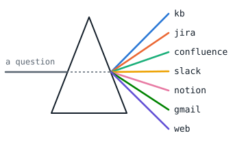
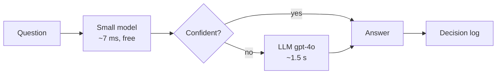
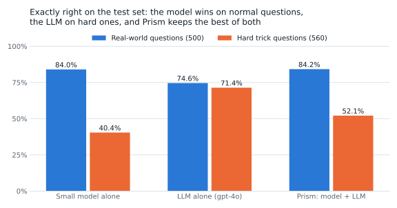
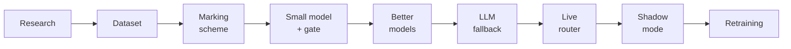
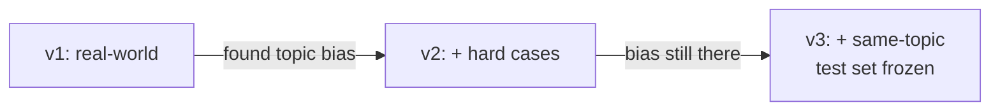
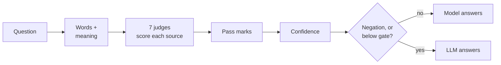
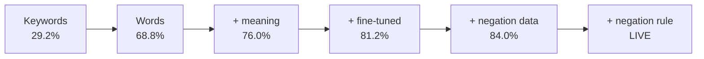
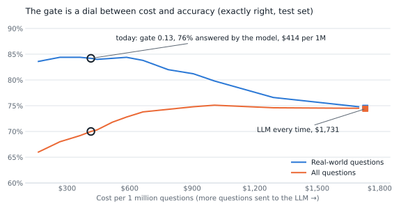
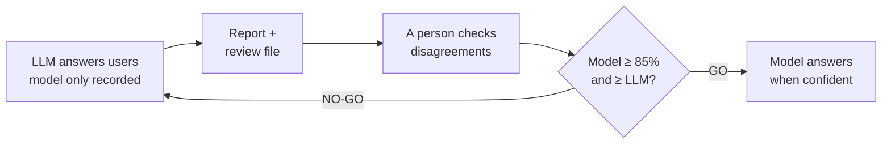
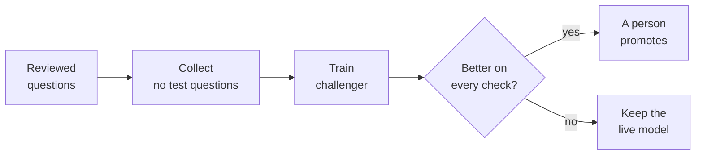

<picture>
  <source media="(prefers-color-scheme: dark)" srcset="docs/images/prism_dark.svg">
  
</picture>

# Aetherion Prism: the Source Router

**Prism decides where to search when someone asks a question at work:** the knowledge base, Jira,
Confluence, Slack, Notion, Gmail or the web. A small model answers most questions in milliseconds
for free; only the hard ones go to an LLM.



| On the frozen test set (1,200 questions) | Model alone | LLM alone | **Prism (model + LLM)** |
|---|---|---|---|
| Real-world questions, exactly right | 84.0% | 74.6% | **84.2%** |
| Hard trick questions, exactly right | 40.4% | 71.4% | **52.1%** |
| Answered without the LLM | 100% | 0% | **76%** |
| Cost per 1M questions | $0 | $1,731 | **$414 (76% cheaper)** |

As accurate as the LLM on normal questions, at a quarter of the cost. Hard trick questions are
still weak, so most of them go to the LLM.

<picture>
  <source media="(prefers-color-scheme: dark)" srcset="docs/images/systems_dark.svg">
  
</picture>

---

## How I built it

**Rule: build the way to measure before the thing to measure.** Every step ended with a number,
a written decision and a commit .



It's a rebuild of my first prototype, which proved the idea but had 27 real problems (the gate
silently became 0, shadow mode never ran, cost was undercounted by 23%). Here every file is
understood and each problem has a fix ([golden rules](#golden-rules)).
Research notes: [RESEARCH.md](RESEARCH.md).

---

## 1. The dataset

No public dataset fits this task, so I built one: **4,419 questions** (3,219 train, 1,200 test).
Each one is labelled with the sources where its answer actually lives: one, several, or none.
Details: **[DATASET.md](DATASET.md)**.

| Part | Rows | Why it's there |
|---|---|---|
| Real-world, from 10 public datasets | 2,500 | Realistic and traceable |
| Hard cases: traps, negation, vague, multi-source | 1,160 | Real data rarely has them |
| Same-topic: 22 topics under every source | 759 | Stops guessing the source from the topic |



Checks: split by document, company names removed, a blind re-label agreed 84% (93% after a fix),
and topic bias fixed (**unseen topics 36% → 74%**). Every row is traceable in `provenance.csv`.
It isn't company data, and AI-written rows are marked.

## 2. How one decision is made



- **Words + meaning:** TF-IDF features joined with a BGE embedding fine-tuned on my labels.
- **7 judges:** one yes/no model per source, so "several" or "none" just works.
- **Pass marks and gate** are learned on separate slices of train, never the test set. The gate is
  the lowest confidence at which kept answers are ≥ 80% right. A gate of 0 is refused.
- **Confidence** comes from the least sure judge: one shaky source makes the whole answer unsure.
- **Negation** ("not the email, …") always goes to the LLM; the model is confidently wrong there.

## 3. The models I trained

One change at a time; every version saved, none overwritten.



*% = real-world questions exactly right.* I also tried **Laya**, a 421M model: fine-tuned, it
scored 85.8% alone, but in the full system it was only a tie, 8× slower and 340× bigger. So I
kept the small model ("model B"). **Lesson:** judge a model inside the full system, not alone.

## 4. The LLM fallback

- **gpt-4o** with structured output: only my 7 labels can come back.
- Errors never crash it: a timeout, retries, then a backup plan.
- **Prompt v1 → v4: 61.7% → 74.4%**, tuned on training questions only. gpt-5 was 2× the cost and 8×
  slower, so I didn't use it.
- LLM answers are **recorded once and replayed for free**, so every comparison is repeatable
  (~$14 spent in total).
- Cost comes from real billed tokens, including cached ones.

**The gate is a dial, chosen on purpose.** Moving right sends more questions to the LLM: cost
rises, but real-world accuracy doesn't. Today's gate (0.13, picked by the 80% rule) sits where
real-world accuracy is at its best and 76% of questions skip the LLM.

<picture>
  <source media="(prefers-color-scheme: dark)" srcset="docs/images/cost_accuracy_dark.svg">
  
</picture>

## 5. Shadow mode: prove it before going live



Answers are judged against human-checked answers, not the LLM: when the two disagreed, the LLM was
right only 47% of the time. **Rehearsal on the test set: NO-GO** (71.3% vs 77.1%). Real-world
questions alone would pass (89.3%); hard cases fail. The process estimated 71.3% from reviewing a
third of the questions, and the true figure was 71.3%, so the check is honest. The real decision
needs 500+ colleague questions.

## 6. Retraining safely



The model never learns from its own answers. Labels come from human review or from the model and
the LLM agreeing. Nothing is promoted automatically, and rollback is one command.

**Two practice rounds** (made-up questions) both ended **not promoted**. The challengers lost a
little on real-world questions (84.2% → 84.0% and 83.2%) and cost more. The rule worked. Next fix:
the model *misses* sources far more than it adds wrong ones (125 vs 31).

---

## Run it

```bash
uv sync && cp .env.example .env           # then put OPENAI_API_KEY in .env (never in git)
uv run streamlit run src/prism/app.py     # web page: ask, batch, live model, models
uv run uvicorn prism.api:app --port 8000  # API: POST /route, GET /health
uv run pytest                             # 114 tests, free (fake LLM)
```

**Fresh laptop:** rebuild the fine-tuned model (it's not in git) by setting
`finetune_on_fit_half: false` in `configs/default.yaml`, then running
`uv run python -m prism.finetune`.

<details>
<summary><b>All commands: evaluation, shadow mode, retraining</b></summary>

| Do this | Command |
|---|---|
| Grade a model by part, type, source | `uv run python -m prism.evaluate` |
| Compare all saved models | `uv run python -m prism.compare` |
| Full system + cost curve (free) | `uv run python -m prism.system_eval tfidf_ftv2_bge_logreg_v2 [curve]` |
| Shadow rehearsal on the test set | `uv run python -m prism.shadow eval` |
| Shadow report + review file / go-live check | `uv run python -m prism.shadowReport logs/<run> [golive]` |
| Retrain | `uv run python -m prism.retrain collect logs/<run>` → `train` → `promote <version> "<what>" "<why>"` |
| Which model is live / undo | `uv run python -m prism.retrain show` · `rollback "<why>"` |

Restart the page and the API after a promotion.
</details>

## Project layout

| Folder | What's in it |
|---|---|
| `configs/` | Every setting, in one file; a missing setting is an error |
| `data/` | `train.csv`, `eval.csv` (frozen), `provenance.csv`, retraining batches |
| `models/` | 14 saved versions, each with a `card.json` (settings, data fingerprint, scores), plus `champion.json` (which model is live, and why) |
| `recordings/` · `results/` | Saved LLM answers · comparison tables |
| `docs/` | The README charts, the prism picture and the script that draws them (`uv run --with matplotlib python docs/make_charts.py`) |
| `src/prism/` · `tests/` | The code · 114 tests |
| *not in git* | `.env` (key), `logs/` (real questions), `finetuned/` (large models) |

<details>
<summary><b>Every code file</b></summary>

| Area | Files |
|---|---|
| Settings, data | `config.py` (checks the YAML) · `data.py` (loads data, cuts train into slices) |
| Small model | `tfidf.py` · `embeddings.py` · `finetune.py` · `logreg.py` (7 judges) · `thresholds.py` · `confidence.py` · `gate.py` · `ruleNegation.py` · `pipeline.py` (the recipe) · `registry.py` (versions, promote, rollback) |
| Grading | `metrics.py` · `evaluate.py` · `baselines.py` · `compare.py` · `system_eval.py` |
| LLM | `llm.py` (prompts, retries, backup plan) · `cost.py` · `llm_answer_eval.py` (record/replay) · `llm_failures.py` · `llm_report.py` |
| Live | `router.py` (`route()` in 3 modes) · `decisionRecord.py` (19-field receipt) · `decisionLog.py` · `app.py` · `batch.py` · `api.py` |
| Learning | `shadow.py` · `shadowReport.py` · `retrain.py` |
| Experiments | `laya_sources.py` · `laya_finetune.py` (kept as evidence) |
</details>

<details>
<summary><b>Debugging guide</b></summary>

Every decision is one row in `logs/decisions_<date>.csv`, so start there.

| What you see | Look at |
|---|---|
| Setting error at start-up | `configs/default.yaml` |
| Model not found | `models/champion.json`; rebuild `finetuned/bge_ft_v2` |
| Wrong source picked | The row's `model_scores` vs the pass marks in `card.json`; `logreg.top_words()` |
| Too many questions go to the LLM | The row's `reason`; the gate in `card.json`; `ruleNegation.py` |
| LLM failed / cost looks wrong | `llm_error` / `cost_spent`, `cost_if_llm`; prices in the YAML |
| A test score changed | The prompt fingerprint in the recording name; the fingerprints in `card.json` |
| Page shows the old model | Restart it after a promotion |
</details>

<details>
<summary><b>Every metric</b></summary>

| Metric | Meaning |
|---|---|
| Exactly right | Every needed source, nothing extra (compared as sets) |
| All needed | Every needed source found; extras allowed |
| Confidence | Least sure judge: 0 = coin flip, 1 = certain |
| Gate | Lowest confidence at which kept answers are ≥ 80% right |
| Answers alone | Share of questions the model answers without the LLM |
| Hard confident mistakes | Hard questions the model answered alone and got wrong |
| Cost per 1M | From real billed tokens; the model costs $0 |
</details>

## Golden rules

The test set never changes · one settings file, missing = error · every model versioned, never
overwritten · the LLM isn't the truth · never train on the model's own answers · prove it in
shadow mode first · always show the breakdown · failures handled, never silent · no secrets or
personal data in git.

## Status

✅ Beats every baseline · ✅ 76% of questions skip the LLM, 76% cheaper · ✅ ~7 ms per decision ·
❌ hard cases and missed sources need work · ⏳ go-live waits on 500+ real colleague questions.
