# Aetherion Prism: the Source Router

**When someone asks a question at work, Prism decides where to search for the answer:** the
knowledge base, Jira, Confluence, Slack, Notion, Gmail or the web.

A small, fast model answers most questions in milliseconds, for free. When it isn't sure, it
hands the question to an LLM. The result is fewer LLM calls, lower cost and faster answers, with
accuracy as good as or better than asking the LLM every time.

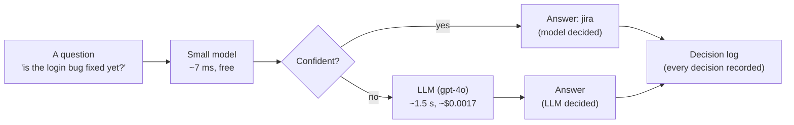

This README explains **everything that was done, from the dataset to retraining**, so a person new
to the project can understand it, run it and debug it. Every number here comes from files in this
repo (`results/`, `models/*/card.json`, `models/champion.json`).

---

## Contents

1. [The problem and the idea](#1-the-problem-and-the-idea)
2. [Results at a glance](#2-results-at-a-glance)
3. [The whole journey, step by step](#3-the-whole-journey-step-by-step)
4. [Step 1: Research](#4-step-1-research)
5. [Step 2: The dataset](#5-step-2-the-dataset)
6. [Step 3: The marking scheme and a baseline](#6-step-3-the-marking-scheme-and-a-baseline)
7. [Step 4: The small model, and how one decision is made](#7-step-4-the-small-model-and-how-one-decision-is-made)
8. [Step 5: Trying better models](#8-step-5-trying-better-models)
9. [Step 6: The LLM fallback](#9-step-6-the-llm-fallback)
10. [Step 7: Model + LLM together](#10-step-7-model--llm-together)
11. [Step 8: The live router and the decision log](#11-step-8-the-live-router-and-the-decision-log)
12. [Step 9: Shadow mode and the go-live check](#12-step-9-shadow-mode-and-the-go-live-check)
13. [Step 10: Retraining safely](#13-step-10-retraining-safely)
14. [The web page and the API](#14-the-web-page-and-the-api)
15. [Every folder and file](#15-every-folder-and-file)
16. [How to run it](#16-how-to-run-it)
17. [Debugging guide](#17-debugging-guide)
18. [Every metric, explained](#18-every-metric-explained)
19. [The golden rules](#19-the-golden-rules)
20. [Limits and what's next](#20-limits-and-whats-next)
21. [Glossary](#21-glossary)

---

## 1. The problem and the idea

A workplace assistant must first decide **where the answer lives**. There are 7 sources:

| Source | Where the answer lives | Example question |
|---|---|---|
| `kb` | Official help, how-to and policy articles | "how do I set up direct deposit?" |
| `jira` | Tickets, bugs, work status | "is the fix for the consumer hang released?" |
| `confluence` | Specs, designs, runbooks, process docs | "what does the design doc say about failover?" |
| `slack` | Chat conversations | "what did people suggest in chat for the wifi issue?" |
| `notion` | Meeting notes, personal and team notes | "what did we decide in Monday's meeting?" |
| `gmail` | Email | "did the client reply about the invoice?" |
| `web` | Public knowledge outside the company | "what is a KV cache?" |
| *(none)* | No search needed | "good morning!" |

A question can need **one** source, **several** (`gmail|notion`), or **none**.

**How it's done today:** tools like LlamaIndex, LangChain and Onyx ask an LLM **every time**.
That is slow (1–2 seconds), costs money on every question, and is overkill: most questions are
easy.

**The idea:** put a small model in front of the LLM. Research calls this a **cascade**: cheap
first, expensive only when needed. Before the model may answer real users alone, it must prove
itself in **shadow mode** (the LLM still answers everyone; the model's answer is only recorded and
checked). Later, it improves from reviewed questions, with a person deciding every change.

**Why this project was rebuilt from scratch:** a first prototype proved the idea works, but had 27
real problems (for example, two different defaults made the gate silently 0, so nothing ever went
to the LLM; shadow mode was built but never run; cost was undercounted by 23%). Prism was rebuilt so
that every file is understood and every one of those problems has a named fix (see
[§19](#19-the-golden-rules)).

---

## 2. Results at a glance

All on the **frozen test set** (1,200 questions that were never used for any choice). Results are
always split by part, because one total would hide where the model fails.

| | Model alone | LLM alone (gpt-4o) | **Model + LLM (live)** |
|---|---|---|---|
| Real-world questions (500) exactly right | 84.0% | 74.6% | **84.2%** |
| Same-topic questions (140) exactly right | 84.3% | 85.7% | **90.7%** |
| Hard trick questions (560) exactly right | 40.4% | 71.4% | **52.1%** |
| All 1,200 exactly right | 63.7% | 74.4% | **70.0%** |
| Questions answered without the LLM | 100% | 0% | **76%** |
| Cost per 1 million questions | $0 | $1,731 | **$414 (76% cheaper)** |
| Time per decision | ~7 ms | ~1.5 s | ~7 ms for 76% of questions |

**In plain words:** on normal questions, Prism is as accurate as or more accurate than the LLM,
at a quarter of the cost. Hard trick questions (negation, misleading words, vague questions) are
still weak; most of them are sent to the LLM.

---

## 3. The whole journey, step by step

The rule throughout: **build the way to measure before building the thing to measure.** Each step
ended with a number, a written decision and a commit.

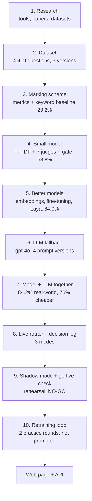

| Date (2026) | Step | Result |
|---|---|---|
| 6 Oct | Research and plan | The problem is known as "resource selection"; the cascade idea is backed by research |
| 6–7 Oct | Dataset v1 → v2 → v3 | 4,419 questions; topic bias found and fixed; test set frozen |
| 7 Oct | Project setup | `uv` + lock file, one settings file with a checker, first tests |
| 8 Oct | Marking scheme, baseline | Keyword rules: 29.2% on real-world questions |
| 8 Oct | First small model + gate | 68.8% real-world; gate chosen from data |
| 10 Oct | Meaning-based embeddings (BGE) | 76.0% real-world |
| 11 Oct | Fine-tuning BGE + negation rule | **84.0%** real-world: model B, the live model |
| 12 Oct | LLM fallback | Prompt v1 61.7% → v4 74.4%; full system 84.2%, 76% cheaper |
| 13 Oct | Bigger challenger (Laya) | Only a tie in the full system, 8× slower: model B kept |
| 13 Oct | Router, log, shadow mode | Rehearsal NO-GO (hard cases); the checking process measured honestly |
| 13–14 Oct | Learning loop, web page, API | collect → train → compare → promote / rollback |
| 14–15 Oct | Two practice retraining rounds | Both challengers correctly **not** promoted |

---

## 4. Step 1: Research

Full notes and links: **[RESEARCH.md](RESEARCH.md)**.

| What already exists | What was borrowed |
|---|---|
| **Onyx, LlamaIndex, LangChain** ask an LLM which sources to search, every time | This is the "LLM every time" approach to beat. Onyx's public benchmark is part of the dataset. |
| **semantic-router** has one threshold per route and "no route" as a valid answer | One pass mark per source; "no search" is a valid answer |
| **Rasa** falls back when it is unsure | Unsure → LLM |
| **RouteLLM** shows results as a cost vs accuracy curve | The cost–accuracy curve in [§10](#10-step-7-model--llm-together) |
| **Papers:** cascades save cost (FrugalGPT, RouteLLM); they work only if low confidence predicts mistakes (Jitkrittum 2023); training on your own answers locks in mistakes (Nature 2024) | Check that confidence predicts mistakes before trusting the gate; never train on the model's own answers |

**No public dataset exists for this exact task**, so one was built.

---

## 5. Step 2: The dataset

Full details: **[DATASET.md](DATASET.md)**.

Each row is a question and **the sources where its answer actually lives**. A question written from
a real Jira ticket is labelled `jira` because its answer is in that ticket, not because it contains
the word "bug".

### Files and columns

| File | What it contains |
|---|---|
| `data/train.csv` | 3,219 questions to train on |
| `data/eval.csv` | 1,200 questions to test on. **Frozen: never changed, never used for any choice** |
| `data/provenance.csv` | Where every row came from (original ID, link, who wrote it) |
| `data/probes/` | Topic-swap test questions (to measure topic bias) |
| `data/new_labels/` | Reviewed questions added by retraining rounds (one file per round) |

Columns: `id`, `question`, `labels` (joined with `|`; empty = no search), `question_type`,
`origin`, `split`.

### Three parts, each with a job

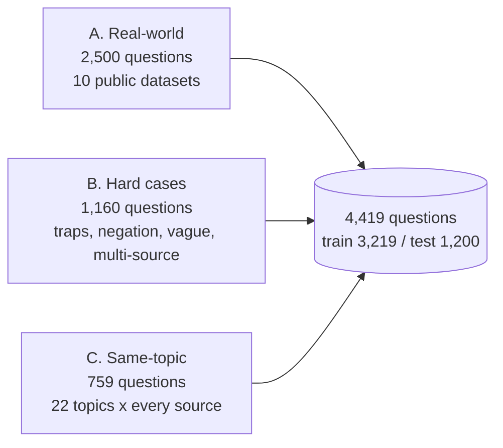

| Part | Train / test | What it is | Why it's there |
|---|---|---|---|
| **A. Real-world** | 2,000 / 500 | Questions from 10 published datasets: EnterpriseRAG-Bench, WixQA, CLINC150, MASSIVE, Natural Questions, ConcurrentQA, QMSum, Apache Kafka Jira, Apache Kafka Confluence, Ubuntu help chat | Realistic questions with traceable sources and checked licences |
| **B. Hard cases** | 600 / 560 | Keyword traps, negation, vague and multi-source questions | Real data rarely contains these, but users ask them |
| **C. Same-topic** | 619 / 140 | 22 topics (KV cache, SSO, billing, …), each written under **every** source | Stops the model guessing the source from the subject |

### How it was built: three versions, each fixing a measured problem

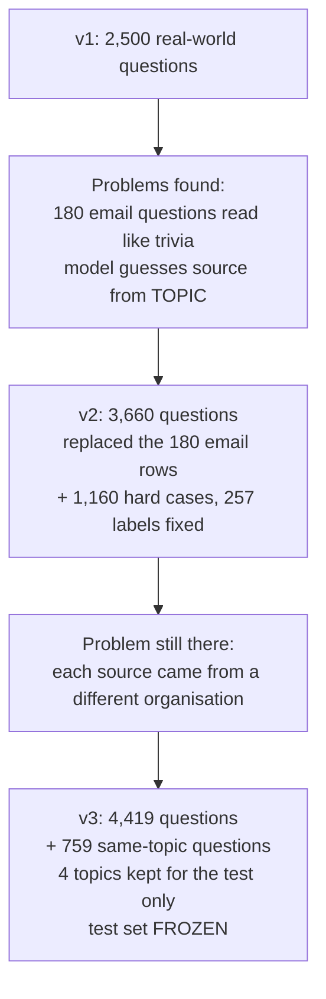

- **v1:** company names (Wix, Kafka, Enron) were removed from questions, so the model can't learn
  "Wix means kb". The split is **by document**: questions from the same ticket or meeting never
  appear in both train and test. Jira, Confluence and Slack had few real "ask an assistant"
  questions, so one question was written per real document (a Kafka ticket, a design page, a chat
  thread).
- **v2:** the 180 unclear email rows were replaced with real email requests and real Google
  searches. 1,160 hard cases were added and converted from 5 labels to 7 (257 labels changed, each
  with a written reason).
- **v3:** 759 same-topic questions. Four whole topics are only in the test set, so the test checks
  topics the model has never seen.

### Labelling rules (used for every label and every review)

1. A named tool counts: "check Slack for…" includes `slack`.
2. Negation removes: "not in Slack" means `slack` is out.
3. Misleading words don't count: "parking ticket", "slack off", "the notion of".
4. Specs, designs, runbooks, process docs → `confluence`. Meeting and personal notes → `notion`.
   Official policy or how-to → `kb`.
5. Public knowledge → `web`. Company topics are never `web`.
6. No information need (greetings, thanks) → no label.
7. Several labels only when clearly needed.

### Seven question types (to see where a model fails)

Each question has exactly one type; if two fit, the harder one (higher in the list) wins.

| Type | Example → label | Rows |
|---|---|---|
| Small talk | "thanks a lot!" → none | 311 |
| Misleading keyword | "I got a parking **ticket**, do we reimburse that?" → kb | 79 |
| Excludes a source | "not the ticket, the design doc for the API" → confluence | 232 |
| Multiple sources | "what did the client email and what did we decide in standup?" → gmail, notion | 426 |
| Unclear source | "anything on feature flags?" | 167 |
| Names the source | "any emails from the vendor about the outage?" → gmail | 576 |
| Implied source | "is the login bug fixed yet?" → jira | 2,628 |

### Checks run on the dataset

| Check | Result |
|---|---|
| Rebuilding from the scripts gives the identical file | ✅ |
| Same document or meeting in both train and test | ✅ Never |
| Company names left in questions | ✅ None |
| Blind label check: 200 rows re-labelled without seeing the original labels | 84% agree; 93% without the email rows removed in v2 |
| Topic bias, model trained on v2 vs v3, same test questions | Unseen topics **36% → 74%**; topic-swap test **43% → 77%**; real-world unchanged (73% → 71%) |

### How the training data is cut (so nothing is tuned on the test)

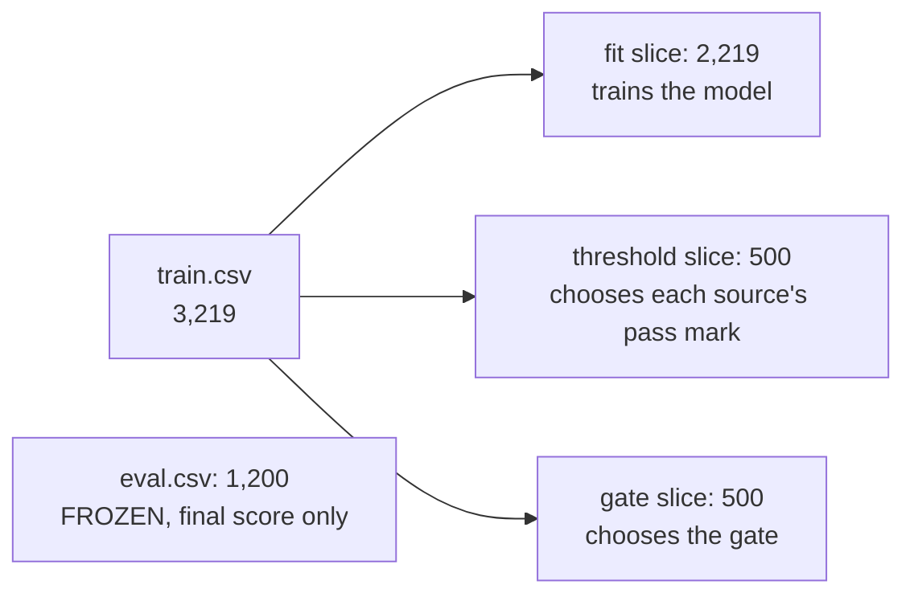

The slices are stratified by part and use a fixed seed (42), so every run gets the same slices.

**Limits, stated openly:** this is **not** company data (no row comes from our employees). Part of
it is AI-written (620 rows written from real documents, 759 same-topic rows, 897 generated hard
cases), and `provenance.csv` marks every one. Labels were checked by AI and spot-checked by hand,
not double-labelled by two people. The dataset was built in a separate folder (build scripts and
earlier versions are not in this repo); DATASET.md §7 and §12 explain how.

---

## 6. Step 3: The marking scheme and a baseline

Before any model existed, the way to grade one was built (`metrics.py`, `evaluate.py`).

| Metric | Meaning |
|---|---|
| **Exact match** | All needed sources picked, nothing extra. Labels are compared as **sets**, so `[a, b]` = `[b, a]` |
| **All needed found** | Every needed source is in the answer (extras allowed) |
| **Precision / recall / F1 per source** | How often a picked source was right / how often a needed source was picked |

One command prints a report **by part, by question type and by source**:
`uv run python -m prism.evaluate`.

**Baseline to beat:** keyword rules (`baselines.py`), written from the labelling rules, never from
the test set: **29.2%** exact on real-world questions.

---

## 7. Step 4: The small model, and how one decision is made

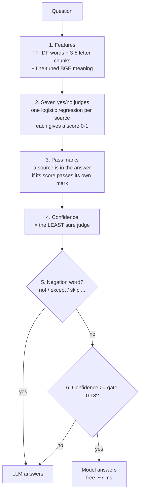

**1. Features** (`tfidf.py`, `embeddings.py`): words and 3–5 letter chunks (these catch clues like
ticket IDs and `#channels`), joined with an embedding (a list of numbers for the *meaning*) from
BGE, fine-tuned on our labels.

**2. Seven judges** (`logreg.py`): one yes/no logistic regression per source. Because each source
is judged separately, "several sources" and "no source" need no special case.

**3. Pass marks** (`thresholds.py`): each source has its own mark, chosen on the **threshold
slice** by best F1. One global 0.5 would be wrong, because sources are common or rare to different
degrees. Live model's marks: kb 0.45, jira 0.45, confluence 0.40, slack 0.50, notion 0.50, gmail
0.50, web 0.45.

**4. Confidence** (`confidence.py`): for each source, how far its score is from its pass mark,
divided by the room on that side:

```
if score >= mark:  sure = (score - mark) / (1 - mark)     # how far into "yes"
else:              sure = (mark - score) / mark           # how far into "no"
confidence = the smallest "sure" of the 7 sources
```

Dividing by the room makes a certain "no" count as much as a certain "yes". The **smallest** is used
because if six sources are clear and one is a coin flip, the whole answer is uncertain; an average
would hide it.

**5. Negation rule** (`ruleNegation.py`): the model is confidently wrong on many "not the email,
the …" questions, and the gate can't catch that because the model doesn't know it's unsure. So
these always go to the LLM. The model's real confidence is still logged.

**6. The gate** (`gate.py`): the **lowest** confidence line where the questions the model keeps are
**at least 80% right** on the gate slice (`accuracy_floor: 0.80` in the YAML). It is computed, never
typed by hand, and saved with the model. A gate of 0 ("never ask the LLM") is refused with an error.
For the live model the gate is 0.13 (78% of gate-slice questions kept, 80.1% right).

Before trusting a gate, it was checked that **low confidence really predicts mistakes**: on the gate
slice, 36% right at confidence 0.0–0.1, rising to 100% at 0.5 and above.

**A worked example:** "is the login bug fixed yet?"

| Source | Score | Mark | In the answer? | Sure |
|---|---|---|---|---|
| jira | 0.91 | 0.45 | ✅ | 0.84 |
| confluence | 0.12 | 0.40 | | **0.70** ← least sure |
| others | ≤ 0.14 | 0.45–0.50 | | 0.72–0.94 |

Answer `[jira]`, confidence 0.70 ≥ gate 0.13 → **the model answers. No LLM call, ~7 ms, $0.**
*(Scores are illustrative; marks and gate are the live model's real ones.)*

**First result** (`tfidf_logreg_v3`, TF-IDF only): **68.8%** real-world vs the keyword baseline's
29.2%. Weak on hard cases (40%), negation and misleading words.

---

## 8. Step 5: Trying better models

One change at a time; every version kept, never overwritten. Names describe the recipe: `tfidf` =
word features, `bge` = meaning features, `ft` = fine-tuned, `logreg` = the 7 judges, `_vN` = version.

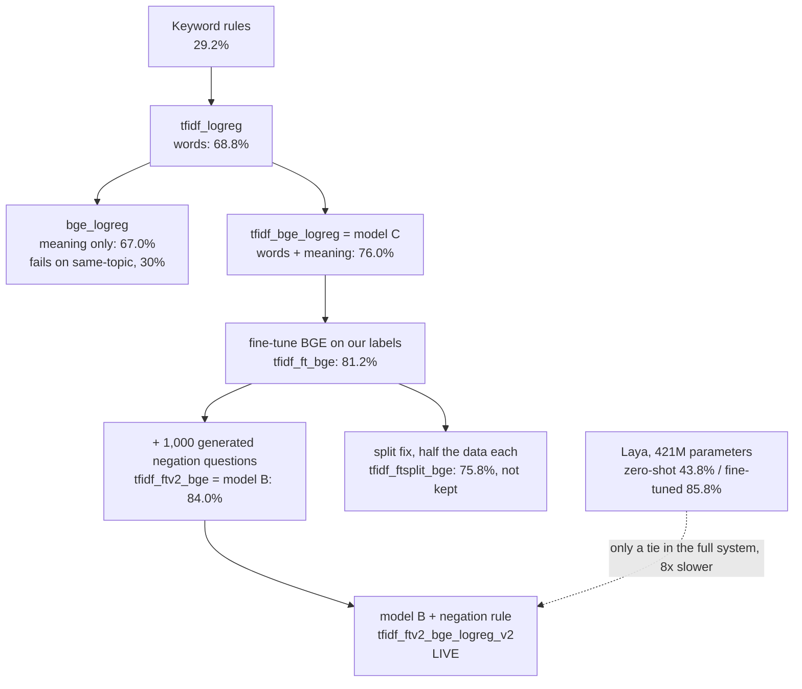

| Model | What changed | Real-world exact | Hard exact | Answers alone | Speed p95 |
|---|---|---|---|---|---|
| keyword rules | Clue words only | 29.2% | n/a | n/a | n/a |
| `tfidf_logreg_v3` | Words + 7 judges + gate (v1 had no gate; v2 is an accidental copy of v1, kept because no model is ever deleted) | 68.8% | 40.0% | 61.0% | 0.6 ms |
| `bge_logreg_v1` | Meaning only. Collapses on same-topic questions (30%) | 67.0% | 30.7% | 41.8% | 6.3 ms |
| `tfidf_bge_logreg_v1` (model C) | Words + meaning | 76.0% | 39.6% | 63.8% | 7.4 ms |
| `ft_bge_logreg_v1` | BGE fine-tuned with same / different / tricky pairs | 77.8% | 33.6% | 75.2% | 5.9 ms |
| `tfidf_ft_bge_logreg_v1` | Words + fine-tuned meaning | 81.2% | 36.2% | 86.7% | 7.3 ms |
| `tfidf_ftv2_bge_logreg_v1` (model B) | + 1,000 generated negation questions in fine-tuning (negation 34% → 41%) | 84.0% | 40.4% | 85.8% | 7.4 ms |
| `tfidf_ftsplit_bge_logreg_v1` | BGE and judges trained on different halves: less over-confident, but less accurate | 75.8% | 37.9% | 68.6% | 7.4 ms |
| **`tfidf_ftv2_bge_logreg_v2`** (model B + rule) **LIVE** | Model B + negation rule: negation confident mistakes 42 → 12; right on 89.3% of the real-world questions it keeps | **84.0%** | 40.4% | 76.2% | 7.4 ms |
| Laya, zero-shot | Ready-made 421M decision model, 7 yes/no questions. Doesn't know our labelling policy | 43.8% | 31.6% | n/a | n/a |
| Laya, fine-tuned 3 epochs | Fine-tuned on the same fit slice | 85.8% | 43.9% | 77% | 54 ms |
| gpt-4o prompt v4 | The LLM alone | 74.6% | 71.4% | n/a | ~1.5 s |

Full tables: `results/model_comparison.md`, `results/laya_comparison.md`,
`results/laya_full_system.md`.

**Why model B + rule is live:** most accurate on normal questions, cheapest full system, ~7 ms. A
stop rule was decided **before** fine-tuning (hard-case kept accuracy ≥ 65%); no model met it (best
~50%). That was written down, and hard cases are left to the LLM and the negation rule, with shadow
mode as the proof.

**Lesson:** always test a candidate **inside the full system** before switching. Laya's better
standalone score did not make a better system (70.8% vs 70.0%: a tie), because the hard cases it
improved are the ones the LLM already handles, and it was worse on normal and same-topic questions.

---

## 9. Step 6: The LLM fallback

`llm.py`, `cost.py`, `llm_answer_eval.py`.

- **Pinned model:** `gpt-4o-2024-11-20`, so results repeat.
- **Structured output:** only our 7 labels can come back; an empty list = no search.
- **The prompt contains the labelling rules**, so the LLM follows the same policy as the labels.
- **Errors never crash:**

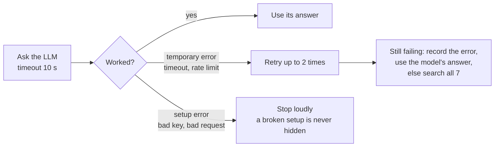

- **Record once, replay free:** the LLM's answers on the test set are saved in `recordings/`
  (file name = question set + model + a fingerprint of the prompt). Every later comparison replays
  them at no cost. A missing recording is an error, never "search nothing". About $14 was spent on
  the LLM in total.
- **Real cost:** from billed token counts, with cached prompt tokens at the cached price, using a
  dated price table in the YAML.

**Four prompt versions**, improved on a practice set of 196 **training** questions (28 per type),
never on the test set. `llm_failures.py` shows where the LLM disagrees with our labels.

| Prompt | Test set: all exact | Notes |
|---|---|---|
| v1 | 61.7% | Kept; new versions are added, never edited |
| **v4 (final)** | **74.4%** | Also best "all needed" (79.0%); $0.00173 per question (87% of prompt tokens cached); p95 1.5 s |
| gpt-5 (tried on practice) | n/a | +3 points, 2× the cost, ~8× slower → not used |

**The LLM is not the truth:** it often adds extra sources, which is why it scores only 74.6% on
real-world questions.

---

## 10. Step 7: Model + LLM together

`system_eval.py` scores the full system on the test set, replaying the recorded LLM answers (free).

| System | All | Real-world | Same-topic | Hard | All needed | Cost / 1M |
|---|---|---|---|---|---|---|
| Model B alone | 63.7% | 84.0% | 84.3% | 40.4% | 68.2% | $0 |
| gpt-4o v4 alone | 74.4% | 74.6% | 85.7% | 71.4% | 79.0% | $1,731 |
| **Model B + gpt-4o (live)** | **70.0%** | **84.2%** | **90.7%** | **52.1%** | 73.2% | **$414** |

**The gate is a dial between cost and accuracy** (`results/cost_accuracy_curve.md`):

| Gate | Model answers | All exact | Real-world exact | Cost / 1M |
|---|---|---|---|---|
| 0.00 | 91% | 66.0% | 83.6% | $162 |
| 0.10 | 79% | 69.2% | 84.4% | $362 |
| **0.13 ← today (80% rule)** | **76%** | **70.0%** | **84.2%** | **$414** |
| 0.20 | 70% | 71.8% | 84.2% | $517 |
| 0.30 | 62% | 73.8% | 83.8% | $664 |
| 0.50 | 48% | 74.8% | 81.2% | $906 |
| 0.80 | 26% | 74.6% | 76.6% | $1,289 |
| LLM every time | 0% | 74.4% | 74.6% | $1,731 |

Real-world accuracy stays flat around 84% up to gate 0.25 while cost rises; overall accuracy keeps
rising until about 0.5 because extra LLM calls fix hard cases.

---

## 11. Step 8: The live router and the decision log

`router.py`, `decisionRecord.py`, `decisionLog.py`.

The `Router` loads the live model **once** (and warms up, which is never logged: the first question
took 1,031 ms without warm-up vs 12 ms with it). `route(question)` works in three modes:

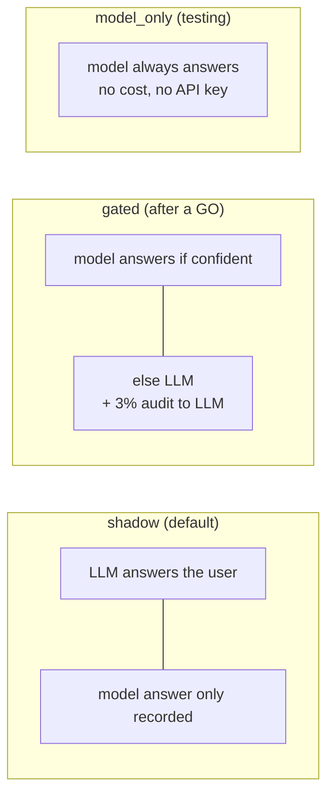

| Mode | Who answers the user | Used for |
|---|---|---|
| `shadow` | Always the LLM; the model's answer is only recorded | Proving the model with zero risk to users |
| `gated` | The model when confident, else the LLM. 3% of confident questions also go to the LLM as an **audit**, so mistakes on confident questions are still found | The goal, after a GO |
| `model_only` | Always the model | Testing |

**Every decision produces a receipt** (the `DecisionRecord`, 19 fields), written as one JSON line
(for code) and one CSV row (for people) to `logs/decisions_<date>.jsonl` / `.csv`:

| Field | Meaning |
|---|---|
| `answer`, `decided_by`, `reason` | What the user got, who decided (`model` / `llm`), and why |
| `model_answer`, `model_confidence`, `model_scores` | What the model said: **always kept**, even when the LLM answered |
| `confidence`, `gate`, `would_escalate` | How sure, the bar, and whether gated mode would have asked the LLM |
| `llm_answer`, `llm_error` | What the LLM said, or why it failed |
| `cost_spent`, `cost_if_llm` | What was paid, and what asking the LLM would have cost |
| `latency_ms`, `mode`, `model_version`, `config_hash` | Time, and exactly which setup made this decision |

`logs/` is never in git (real questions stay on the laptop).

---

## 12. Step 9: Shadow mode and the go-live check

`shadow.py`, `shadowReport.py`.

Think of a trainee next to an expert: the LLM answers everyone; the model writes down what it
*would* have said; afterwards, they are compared.

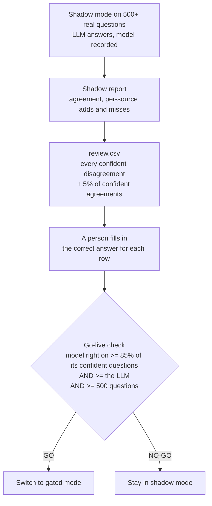

**Why checked answers and not "agreement with the LLM":** on the test set, when the model and the
LLM disagreed, **the LLM was right only 47% of the time**. A rule based on agreement would punish a
correct model. The 5% spot-check of agreements catches the case where both agree and both are
wrong (agreements were really right 93%).

**Rehearsal on the test set** (LLM answers replayed from the recording):

| | Result |
|---|---|
| Model right on its confident questions | 71.3% vs LLM 77.1% → **NO-GO** |
| Real-world questions only | 89.3% (would pass) |
| Same-topic questions only | 91.9% (would pass) |
| Hard cases only (47% of the test set, on purpose) | 45.6% (fails) |
| **Is the checking process honest?** | Estimated 71.3% = true 71.3%, after reviewing only 348 of 1,200 questions ✅ |

The real go-live decision needs 500+ real questions from colleagues.

---

## 13. Step 10: Retraining safely

`retrain.py`, `registry.py`.

Training a model on its own answers locks in its mistakes, so the loop has hard rules built into the
code, and **nothing is promoted automatically**.

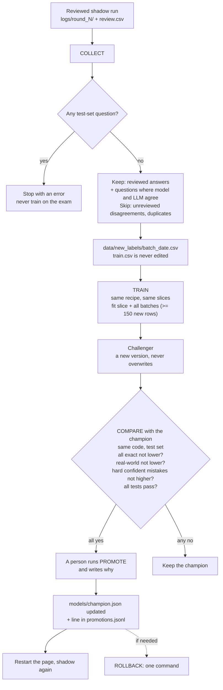

- `models/champion.json` says which model is live, in plain words, with evidence. The router reads
  it; there is no second place that can disagree.
- `models/promotions.jsonl` is the history of every promotion and rollback (appended, never
  rewritten).
- The challenger uses the champion's recipe and the **same** threshold and gate slices, so the
  only difference is the new data.

### Two practice rounds (with made-up questions)

Real colleague questions aren't available yet, so the whole loop was run end to end with made-up
practice questions (`samples/`, with answer keys).

| | Champion (live) | Round 1 challenger | Round 2 challenger |
|---|---|---|---|
| Version | `tfidf_ftv2_bge_logreg_v2` | `tfidf_ftv2_bge_logreg_v3` | `tfidf_ftv2_bge_logreg_v4` |
| Shadow questions / reviewed rows / new training rows | n/a | 502 / 122 / 439 | 500 / 134 / 419 (858 total) |
| Full system, all exact | 70.0% | 70.8% ✅ | 69.9% ❌ |
| Full system, real-world exact | 84.2% | 84.0% ❌ | 83.2% ❌ |
| Hard-case confident mistakes per 100 | 37.3 | 34.6 ✅ | 35.7 ✅ |
| Model answers alone | 76.2% | 73.3% | 73.8% |
| Cost per 1M questions | $414 | $465 | $458 |
| **Decision** | stays live | **not promoted** | **not promoted** |

**What was learned:**
- The rule works: round 1 was better overall and on hard cases, but slightly worse on normal
  questions and 12% more expensive, so it stayed out.
- Made-up questions don't look like real-world questions. They moved the pass marks (kb 0.45 →
  0.65) and made the model less confident. The loop needs real questions.
- In both shadow runs the model **missed** sources far more often than it added wrong ones (round 2:
  125 misses vs 31 adds; Jira alone 36). It under-picks on multi-source questions.
- Cost is not part of the promotion rule yet (an open decision).

---

## 14. The web page and the API

Both are thin windows over the same `router.route()` and write to the same log. Neither contains
decision logic.

**Web page** (`app.py`, Streamlit), six tabs:

| Tab | What it shows |
|---|---|
| **Ask** | Ask a question → sources, who decided, confidence, time, cost and money saved; the model's and the LLM's answers side by side |
| **Batch** | Paste many questions or upload `.txt` / `.csv` / `.xlsx` → preview → route all (limit 500) → download results as CSV |
| **Live model** | Which model answers now and why, all its numbers, the history of promotions, a warning if a restart is needed |
| **Models** | Every model tried, with its numbers; model + LLM vs Laya |
| **This session** | Counts for this session, shadow progress (x / 500) |
| **How it works** | The flow, in plain words |

**API** (`api.py`, FastAPI):

```
POST /route   {"question": "is the login bug fixed?", "mode": "gated"}   → the decision record (JSON)
GET  /health  → running?, live model version, default mode
```

Interactive docs at http://localhost:8000/docs.

---

## 15. Every folder and file

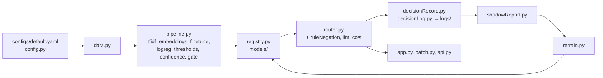

### Folders

| Folder | What's in it | In git? |
|---|---|---|
| `configs/` | `default.yaml`: every setting. A missing setting is an error | ✅ |
| `data/` | `train.csv`, `eval.csv` (frozen), `provenance.csv`, `probes/`, `new_labels/` | ✅ |
| `models/` | 14 saved versions (`<recipe>_vN/` with `model.joblib` + `card.json`), `champion.json`, `promotions.jsonl` | ✅ |
| `recordings/` | Saved LLM answers (per question set, model and prompt fingerprint) and Laya scores: replayed for free | ✅ |
| `results/` | `model_comparison.md`, `cost_accuracy_curve.md`, `laya_comparison.md`, `laya_full_system.md` | ✅ |
| `samples/` | Made-up practice question sets 1–3 with answer keys, for testing the retraining loop | ✅ |
| `src/prism/` | The code (below) | ✅ |
| `tests/` | 31 test files, 114 tests; `fakes.py` is a fake LLM, so tests are free and need no key | ✅ |
| `.streamlit/` | The web page's colours | ✅ |
| `finetuned/` | Fine-tuned BGE and Laya models, ~130 MB each (too big for git; rebuild, see §16) | ❌ |
| `logs/` | Real decision logs and review files | ❌ |
| `.env` | The OpenAI key (`.env.example` shows the shape) | ❌ |

**Each `card.json`** records the recipe, every setting used, a fingerprint of the training data, the
7 pass marks, the gate, the gate-slice numbers, the test-set scores, and (for retrained models) the
batches it learned from. Any number can be traced back to the exact setup that made it.

### Code (`src/prism/`)

**Settings and data**

| File | What it does |
|---|---|
| `config.py` | Reads `configs/default.yaml` and checks it (pydantic). Missing or wrong setting → clear error |
| `data.py` | Loads the CSVs (labels become sets); `part_of()` = real-world / hard / same-topic; `split_train()` = fit / threshold / gate slices; `prompt_practice_set()` |

**The small model**

| File | What it does |
|---|---|
| `tfidf.py` | Words + 3–5 letter chunks → numbers |
| `embeddings.py` | Any Hugging Face embedding model (BGE now) → meaning numbers |
| `finetune.py` | Makes training pairs (same / different / tricky), adds 1,000 negation questions, fine-tunes BGE |
| `logreg.py` | The 7 yes/no judges; `top_words()` shows which words push each judge |
| `thresholds.py` | Each source's pass mark, best F1 on the threshold slice |
| `confidence.py` | `how_sure()` per judge; `confidence()` = the least sure one, and which source |
| `gate.py` | Risk–coverage table; `choose_gate()` (lowest gate with ≥ 80%, refuses 0) |
| `ruleNegation.py` | Negation words → always the LLM |
| `pipeline.py` | The recipe in one place: features → judges → pass marks → gate |
| `registry.py` | Save / load versions (never overwritten; no gate = refused); champion, promote, rollback |

**Grading and comparing**

| File | What it does |
|---|---|
| `metrics.py` | Exact match, all needed found, precision / recall / F1 |
| `evaluate.py` | Report by part, question type and source |
| `baselines.py` | Keyword rules (the bar to beat) |
| `compare.py` | All models side by side → `results/model_comparison.md` (accuracy, gate, speed, size) |
| `system_eval.py` | Model + LLM on the test set (free replay) + the cost–accuracy curve |

**The LLM**

| File | What it does |
|---|---|
| `llm.py` | Connection, the 4 prompts, structured output, `ask_llm_safely()` (retries + backup plan) |
| `cost.py` | Cost from real billed tokens, including cached ones |
| `llm_answer_eval.py` | Record a question set's LLM answers once; replay them |
| `llm_failures.py` | Where the LLM disagrees with our labels (practice set only) |
| `llm_report.py` | How good the LLM is and what it costs, from the recording |

**The live system**

| File | What it does |
|---|---|
| `router.py` | `Router` loads the champion once; `route()` in 3 modes, negation rule, audit, backup plan |
| `decisionRecord.py` | The 19-field receipt; `money_saved()`, `model_and_llm_agree()` |
| `decisionLog.py` | Writes `logs/decisions_<date>.jsonl` + `.csv`, one writer with a lock |
| `app.py` | The Streamlit page (6 tabs) |
| `batch.py` | Split pasted text / read uploaded files → route each → rows for CSV |
| `api.py` | FastAPI: `POST /route`, `GET /health` |

**Shadow mode and learning**

| File | What it does |
|---|---|
| `shadow.py` | Rehearsal: test questions through the real router, with replayed LLM answers |
| `shadowReport.py` | Agreement, adds and misses per source, `review.csv`, the go-live check |
| `retrain.py` | `collect`, `train` (+ compare), `promote`, `rollback`, `show` |

**Experiments kept for evidence (not used live)**

| File | What it does |
|---|---|
| `laya_sources.py` | Laya asked 7 yes/no questions (zero-shot); scores recorded once |
| `laya_finetune.py` | Fine-tunes Laya on the fit slice, fairly, like every other model |

The code uses plain `for` loops and `if / else` (no one-liners), so every step can be followed in a
debugger.

---

## 16. How to run it

**Set up once**

```bash
uv sync                                   # installs Python 3.12 + every library from uv.lock
cp .env.example .env                      # then put your real OPENAI_API_KEY in .env (never in git)
```

**Fresh laptop:** the live model needs `finetuned/bge_ft_v2` (not in git). Rebuild it: set
`finetune_on_fit_half: false` in `configs/default.yaml`, run `uv run python -m prism.finetune`,
then set it back to `true`.

**Use it**

| Do this | Command |
|---|---|
| Web page | `uv run streamlit run src/prism/app.py` |
| API | `uv run uvicorn prism.api:app --port 8000` |
| All tests | `uv run pytest` |
| Grade a model (by part, type, source) | `uv run python -m prism.evaluate` |
| Compare all saved models | `uv run python -m prism.compare` |
| Full system on the test set (free) | `uv run python -m prism.system_eval tfidf_ftv2_bge_logreg_v2` |
| Cost–accuracy curve | `uv run python -m prism.system_eval tfidf_ftv2_bge_logreg_v2 curve` |
| Shadow rehearsal on the test set | `uv run python -m prism.shadow eval` |

**A real shadow run → go-live check**

1. Keep `mode: shadow` and collect 500+ real questions (the page or the API).
2. `uv run python -m prism.shadowReport logs/<run folder>` → prints agreement, writes `review.csv`.
3. Open `review.csv` in Excel; fill `correct_answer` on every row (e.g. `jira|slack`, or `none`).
4. `uv run python -m prism.shadowReport logs/<run folder> golive` → GO or NO-GO.

**A retraining round** (after a reviewed shadow run, at least 150 new reviewed rows)

```bash
uv run python -m prism.retrain collect logs/<run folder>     # → data/new_labels/batch_<date>.csv
uv run python -m prism.retrain train                         # → challenger + comparison: CAN be promoted / NOT better
uv run python -m prism.retrain promote <version> "<what it is>" "<why>"   # only if it can, and you agree
# restart the page and the API so they load the new champion
uv run python -m prism.retrain show                          # which model is live, and why
uv run python -m prism.retrain rollback "<why>"              # back to the previous model
```

---

## 17. Debugging guide

Every decision's receipt is in `logs/decisions_<date>.csv` (opens in Excel). Most questions can be
answered from one row.

| What you see | Where to look |
|---|---|
| Start-up error: setting missing or invalid | `configs/default.yaml`, checked by `config.py`. Every setting must be present |
| Start-up error: model or `finetuned/bge_ft_v2` not found | `models/champion.json` names the live version; rebuild the fine-tuned BGE (§16) |
| A question went to the wrong source | Its log row: `model_scores` vs the pass marks in that model's `card.json`; `logreg.top_words()` shows which words pushed the judge |
| Too many / too few questions go to the LLM | The log's `reason` and `would_escalate`; the gate in `card.json`; did `ruleNegation.has_negation()` match? |
| The LLM call failed | `llm_error` in the log; `llm.ask_llm_safely()` chose the backup plan |
| Cost or savings look wrong | `cost_spent` / `cost_if_llm` in the log; `llm_prices` in the YAML; `cost.py` |
| A test-set score changed unexpectedly | The prompt fingerprint in the recording's file name; `train_data_fingerprint` and `settings` in `card.json` |
| "Recording missing" error | That prompt/model hasn't been recorded: run `uv run python -m prism.llm_answer_eval` |
| `retrain collect` refuses the run | The run contains test-set questions (on purpose: never train on the exam) |
| `retrain train` says not enough rows | Fewer than `retrain_min_new_rows` (150) reviewed rows |
| Promoted a model but the page shows the old one | Restart the page; the **Live model** tab warns when they differ |
| Something looks wrong on the page | The page has no logic: debug `router.py` / `decisionRecord.py` |

---

## 18. Every metric, explained

| Metric | Plain meaning | Computed in |
|---|---|---|
| **All exact** (exact match) | Every needed source picked, nothing extra (compared as sets) | `metrics.exact_match` |
| **All needed** | Every needed source is in the answer; extras allowed | `metrics.found_all_needed` |
| **Precision / recall / F1 per source** | Picked-and-right / needed-and-picked / their balance | `metrics.per_source_scores` |
| **Real-world / same-topic / hard** | The same metric on the 500 / 140 / 560 test questions of each part | `data.part_of`, `evaluate.py` |
| **Confidence** | The least sure judge; 0 = coin flip, 1 = certain | `confidence.confidence` |
| **Gate** | The confidence line; lowest value with ≥ 80% right on kept (gate slice) | `gate.choose_gate` |
| **Coverage** / model answers alone | Share of questions the model answers without the LLM | `gate.coverage_at`, `system_eval` |
| **Right on kept** | Accuracy on only the questions the model answered itself | `gate.risk_coverage` |
| **Hard confident mistakes per 100** | Out of 100 hard questions, how many the model answered alone and got wrong | `system_eval.full_system_numbers` |
| **Cost per 1M questions** | From real billed tokens; the model costs $0 | `cost.llm_call_cost` |
| **p50 / p95 ms** | Typical and slow-end time per decision on new questions | `compare.speed_ms` |
| **Agreement (all / confident)** | In shadow mode, how often model and LLM gave the same set | `shadowReport.shadow_report` |
| **Go-live accuracy** | Model right on its confident questions, vs checked answers | `shadowReport.go_live_check` |

---

## 19. The golden rules

Each rule exists because the first prototype broke it.

1. **The test set never changes**, and nothing is tuned on it.
2. **Every setting lives in one config file**; a missing setting is an error. *(Prototype: two
   defaults, 0.60 vs 0.80, made the gate silently 0.)*
3. **Every run saves its settings, data fingerprint and scores** (`card.json`).
4. **Every model gets a unique version**; nothing is overwritten. *(Prototype: retrained models
   overwrote each other.)*
5. **The LLM is never treated as automatically correct.** *(Prototype: it matched labels only 65.7%
   of the time.)*
6. **Never train on the model's own answers.**
7. **Prove it in shadow mode before going live.** *(Prototype: shadow mode was never run.)*
8. **Always show the breakdown**, and savings next to accuracy.
9. **Failures are logged and handled**, never silent, never crashes. *(Prototype: LLM errors
   crashed requests; a missing recording meant "search nothing".)*
10. **No secrets and no personal data in git or logs.**

---

## 20. Limits and what's next

| Target | Status |
|---|---|
| Beat every baseline on real-world questions | ✅ 84.0% vs 29.2% |
| Model + LLM within 2 points of LLM-only on real-world | ✅ 9.6 points above it |
| At least 40% of questions answered without the LLM | ✅ 76% |
| Kept questions at least 80% right | ✅ real-world 89.3% · ❌ overall 71.3% (hard cases) |
| Needed sources found at least 90% of the time | ❌ 73.2% |
| At least 40% cheaper than LLM-only, from real billing | ✅ 76% |
| Model decision p95 under 50 ms | ✅ ~7 ms |
| Shadow GO on 500+ real questions | ⏳ rehearsal done; needs real questions |
| A fresh copy installs, passes the tests and runs the demo | ⏳ next |

**Known weaknesses:** hard trick questions (especially unclear ones), and the model missing sources
on multi-source questions.

**Next:**
1. A real shadow run with 500+ colleague questions → the go-live decision.
2. The first real retraining round from reviewed real questions.
3. Decide whether cost belongs in the promotion rule.
4. Privacy rules (masking personal data) before real company traffic.
5. A small adapter around `route()` for the company platform (`route()` has no platform dependency).

---

## 21. Glossary

| Term | Plain meaning |
|---|---|
| **Source / label** | Where the answer lives: kb, jira, confluence, slack, notion, gmail, web |
| **Score** | A judge's 0–1 rating for one source |
| **Pass mark (threshold)** | A source's own line; above it, the source is in the answer |
| **Confidence** | How sure the model is about its whole answer (its shakiest source) |
| **Gate** | The confidence needed to trust the model; below it, ask the LLM |
| **Cascade** | Cheap model first, expensive one only when needed |
| **Shadow / gated / model-only** | LLM always answers (model recorded) / model when confident / model always |
| **Audit sample** | Random confident questions still sent to the LLM, to keep checking the model |
| **Coverage** | Share of questions answered without the LLM |
| **Fine-tuning** | Training a ready-made model a little more on our own labels |
| **Embedding** | A list of numbers that captures a sentence's meaning |
| **Champion / challenger** | The live model / a newly trained model trying to replace it |
| **Recording / replay** | Save the LLM's answers once and reuse them for free |
| **Model B** | `tfidf_ftv2_bge_logreg`: TF-IDF words + fine-tuned BGE meaning + 7 judges. Live version: `_v2`, with the negation rule |
| **Test set (eval, frozen)** | The 1,200 questions used only for final scores, never changed |
